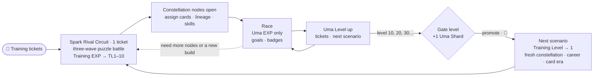
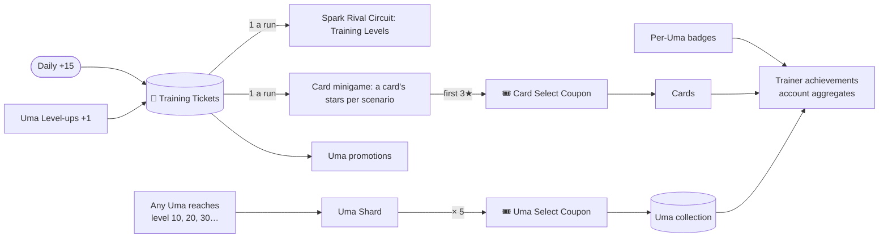

# Overview

## Vision

A pocket-sized Uma Musume RPG where **every Uma is a long-term companion and the stable is a
collection**. Each Uma has a permanent level and climbs through the game's history one scenario at a
time. Along the way she spars in puzzle battles, configures a constellation with the support cards and lineage of each
era, and proves herself in races that feed her progression and fill her trophy case.

## Design pillars

1. **Progress is permanent.** Uma Levels, owned cards, race records, and badges never reset. What deliberately starts
   over in each scenario is the career: its Training Level, its constellation, its card set, and every card's **bond**
   (D121, D127).
2. **Races are the payoff.** Races can be lost. Umas slowly outgrow the field as they level.
3. **History unfolds in order.** Scenarios are eras. A card becomes equippable in the era it was
   originally released and stays equippable afterwards.
4. **Collect everything.** Umas, SSR cards, badges, titles, and account achievements all have visible completion.
5. **Flair everywhere.** Every meaningful accomplishment leaves a visible mark on the Uma and on the account.
6. **Soft limits, never walls.** Training tickets (the one currency) and coupons set the pace. Nothing
   expires, and missing a day never costs progress.

## Core loops

### Uma loop (per Uma)

### Collection loop (account)

## How this differs from the original game

| Original game | Uma Racer |
|---|---|
| A career run makes a one-off trained Uma instance | Each Uma is permanent, with a permanent **Uma Level** (from races) and a per-scenario **Training Level** (from training) |
| Training is limited by career turns | Training is a **puzzle-battle and constellation loop**, paced by **15 daily tickets banked to 60** |
| Scenarios are separate career modes you pick | Scenarios are **progression tiers**, 10 levels each, in release order |
| R / SR / SSR support cards | **SSR cards only** |
| Gacha for Umas and cards | Free/event cards to start, then **Select Coupons** earned by maxing cards and leveling Umas |
| Duplicate copies limit break cards | Cards are unlocked with **Card Select Coupons** (D198); a card's **stars** (0★–3★, D200) are earned per scenario in the card minigame and start over in each one |
| Detailed training formulas with heavy RNG | **Skill-based seeded minigames** open a deterministic constellation; assigned nodes derive the build |
| Skill points spent during a career | **SP is derived per scenario**, and the Uma **fine-tunes a skill loadout** within it |
| Sparks inherited from a finished career's legacy | Six manually chosen lineage slots use owned Uma templates; repeated A/S aptitudes raise grades and their baseline awakening skills join the library |
| Career goals are mandatory, and failing ends the run | **A career per scenario** — a G3, two G2s, then a G1 set in her profile — that holds her Uma Level until each stage is won. Losing a goal race costs only the race: goals are retried, never failed |
| Gacha for a starting roster | **All 25 original launch trainees** are available from the start |
| Mostly flat difficulty inside a career | **The grade handicap**: rivals are a trained Uma made weaker by the race's grade, most at G3 and least at G1, so a fully trained Uma is favoured and a G1 is the real test |
| Epithets and titles are a side feature | **Badges, titles, and collection are core pillars** |

## Glossary

| Term | Meaning |
|---|---|
| **Uma** | A playable character. It has static template data (base stats, growth rates, aptitudes, unique skill) and a persisted instance with permanent level plus per-scenario constellations and records. Stats, aptitudes, SP and skill library are derived from the active constellation. |
| **Uma Level** | Permanent level earned **only from racing**. Levels 1–10 are scenario 1, 11–20 are scenario 2, and so on. |
| **Training Level (TL)** | 1–10, earned **only from Spark Rival Circuit**, and fresh in each scenario. It decides which constellation nodes are open; it does not multiply stats or caps. |
| **Training Ticket** | **The only currency.** One ticket is one minigame run. Earned from the daily +15 (stored up to 60, four days) and Uma Level-ups. Spent on minigame runs and unlocking the next scenario; cards take a Card Select Coupon (D198). |
| **Scenario / Tier** | A 10-level band named after an original career scenario. It sets stat and SP caps and which card era is available. |
| **Gate level** | Level 10, 20, 30… Grants an Uma Shard. EXP stops at the maximum until promotion. |
| **Promotion** | Spending training tickets to move an Uma to the next scenario. |
| **Stat cap / SP cap** | A scenario's per-stat and skill-point ceilings. The constellation derives values up to them; Training Level controls access to nodes rather than multiplying the caps. |
| **Era** | The scenario window in which a card was originally released. |
| **Support card** | An SSR card placed in a scenario's card set; it pays stats (or, for a Friend or Group card, SP) and skills on the constellation nodes it fills. It has a type and an era. |
| **Stars** | A card's power in one scenario, 0★ to 3★ (D200). Earned one per clear of the card minigame (**Bond** is that act), shared by every Uma in that scenario, and zero in each new one. There is no card level. |
| **Card Select Coupon** | Earned the first time a card reaches 3★ anywhere. The only way to unlock a card (D198). Stackable, never expires. |
| **Uma Shard / Uma Select Coupon** | 1 shard each time an Uma reaches a gate level. 5 shards make a coupon that redeems for any Uma. |
| **SP (Skill Points)** | Derived loadout capacity in the active scenario. Training Level and Friend/Group card nodes supply it, up to the scenario cap. |
| **Skill library / loadout** | Skills currently made available by the active constellation, and their ordered equipped subset. Skills race in order while they fit the derived SP; the rest sit out. |
| **Lineage** | Six constellation slots—two parents and four grandparents—each referencing any owned Uma template. They contribute baseline awakening skills and repeated strong aptitude grades. There are no snapshots. |
| **Scenario Start** | The confirmation that activates a new per-scenario constellation, card set, career and race record at TL1. Spark Match then opens more nodes. |
| **Drive / Resolve** | Temporary Spark Rival Circuit battle gauges for trainee and rival. They are not race HP, Stamina stats, currencies or saved progression. |
| **Career** | Each scenario's per-Uma race plan in three stages — Maiden (a G3), Trials (two G2s), Main goals (a G1 set) — built from her best two distances and her real career. Maiden and Trials hold levels 2 and 5; the whole career gates the advance. Shown as a tracker, race-card icons, ribbons and Honors crests. |
| **Grade handicap** | How much weaker than a typical trained Uma a race's rivals are: 5% at G1, 15% at G2, 25% at G3, more below. Your Uma races with the stats on her profile. |
| **Badge / Title** | Tiered per-Uma accomplishment, or a named honor (for example "Triple Crown"). |
| **Trainer achievement** | Account-wide accomplishment covering collection and totals across all Umas. |
| **Aptitude** | Letter grade (S–G) for surface (Turf/Dirt), distance (Sprint/Mile/Medium/Long), and strategy (Front/Pace/Late/End). |
