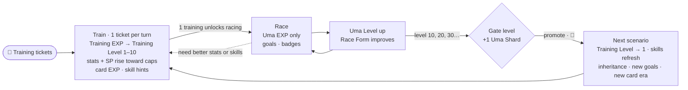
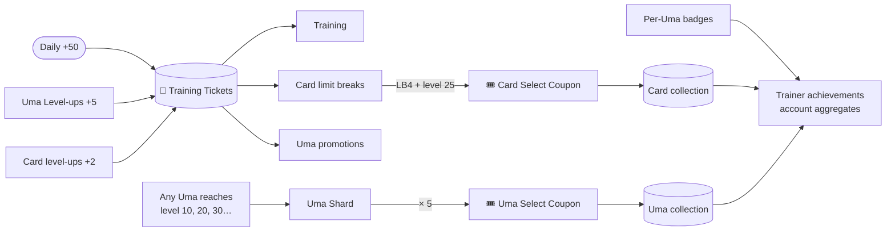

# Overview

## Vision

A pocket-sized Uma Musume RPG where **every Uma is a long-term companion and the stable is a
collection**. Each Uma has a permanent level and climbs through the game's history one scenario at a
time. Along the way she trains with the support cards of each era, learns skills, inherits from the
Umas who came before her, and proves herself in races that feed her progression and fill her trophy case.

## Design pillars

1. **Progress is permanent.** Levels, stats, SP, card levels, race records, and badges never reset. The one deliberate
   exception is the **skill library**, which is re-earned each scenario from that scenario's cards and parents.
2. **Races are the payoff.** Races can be lost. Umas slowly outgrow the field as they level.
3. **History unfolds in order.** Scenarios are eras. A card becomes equippable in the era it was
   originally released and stays equippable afterwards.
4. **Collect everything.** Umas, SSR cards, badges, titles, and account achievements all have visible completion.
5. **Flair everywhere.** Every meaningful accomplishment leaves a visible mark on the Uma and on the account.
6. **Soft limits, never walls.** Training tickets (the one currency) and coupons set the pace. Nothing
   expires, and missing a day never costs progress.

## Core loops

### Uma loop (per Uma)

### Collection loop (account)

## How this differs from the original game

| Original game | Uma Racer |
|---|---|
| A career run makes a one-off trained Uma instance | Each Uma is permanent, with a permanent **Uma Level** (from races) and a per-scenario **Training Level** (from training) |
| Training is limited by career turns | Training is **unlimited in principle**, paced by **50 daily training tickets** |
| Scenarios are separate career modes you pick | Scenarios are **progression tiers**, 10 levels each, in release order |
| R / SR / SSR support cards | **SSR cards only** |
| Gacha for Umas and cards | Free/event cards to start, then **Select Coupons** earned by maxing cards and leveling Umas |
| Duplicate copies limit break cards | Cards **level up through use**, and limit breaks cost **training tickets** |
| Detailed training formulas with heavy RNG | **Simplified formulas**, where newer cards are straightforwardly stronger |
| Skill points spent during a career | **SP capped per scenario**, and the Uma **fine-tunes a skill loadout** within it |
| Sparks inherited from a finished career's legacy | **2 parents automatically pass** a weaker unique and their white skills. From the **4 grandparents** you pick 2 uniques and half of their whites. Lineups come from each Uma's latest **parent snapshot** |
| Career goals are mandatory, and failing ends the run | **Optional scenario goals** based on aptitudes and the real horse's identity, shown prominently as ribbons, crests, and badges |
| Gacha for a starting roster | **All 25 original launch trainees** are available from the start |
| Mostly flat difficulty inside a career | **Race Form**: each scenario starts as a fair fight, and your Uma pulls ahead as she levels |
| Epithets and titles are a side feature | **Badges, titles, and collection are core pillars** |

## Glossary

| Term | Meaning |
|---|---|
| **Uma** | A playable character. It has static template data (base stats, growth rates, aptitudes, unique skill) and a persisted instance (level, stats, skills, record). |
| **Uma Level** | Permanent level earned **only from racing**. Levels 1–10 are scenario 1, 11–20 are scenario 2, and so on. Sets Race Form. |
| **Training Level (TL)** | 1–10, earned **only from training**, and reset at each scenario start. Sets the stat and SP caps (80% of the scenario baseline at TL1, 100% at TL10). |
| **Training Ticket** | **The only currency.** Earned from the daily +50 (stored up to 500), Uma Level-ups, and card level-ups. Spent on training, Uma promotions, and card limit breaks. |
| **Scenario / Tier** | A 10-level band named after an original career scenario. It sets stat and SP caps and which card era is available. |
| **Gate level** | Level 10, 20, 30… Grants an Uma Shard. EXP stops at the maximum until promotion. |
| **Promotion** | Spending training tickets to move an Uma to the next scenario, or a card to its next limit break. |
| **Stat cap / SP cap** | The highest value training can raise stats or SP to: the scenario baseline × the Training Level multiplier. Caps never reduce a stat. |
| **Era** | The scenario window in which a card was originally released. |
| **Support card** | An equippable SSR card that boosts training and gives skill hints. It has a type, era, level, and limit break. |
| **LB (Limit Break)** | Card power tier, from LB0 to LB4 (MLB). Each LB covers 5 card levels. |
| **Card Select Coupon** | Earned when a card reaches LB4 and level 25. Redeems for any card. Stackable, never expires. |
| **Uma Shard / Uma Select Coupon** | 1 shard each time an Uma reaches a gate level. 5 shards make a coupon that redeems for any Uma. |
| **SP (Skill Points)** | Loadout capacity from training, capped per scenario. Equipped skills must fit within it. |
| **Skill library / loadout** | Every skill an Uma has learned, and the subset currently equipped. |
| **Scenario start / inheritance** | At the start of every scenario, the Uma picks 0–2 parents. Parents pass their unique (weaker) and white skills, and the player picks some grandparent skills. |
| **Parent snapshot** | A fully frozen record of an Uma (her inheritable skills) and the parents she trained with, saved when she completes a scenario. Picking her as a parent uses this snapshot. To refresh it, retrain her. |
| **Skill library** | Every skill an Uma has unlocked **in her current scenario** (own unique, card hints, inherited). Refreshed at each scenario start. |
| **Opening training** | One training turn in a new scenario, which unlocks its races. |
| **Loadout** | The skills currently equipped from the library. Total cost must be ≤ SP. |
| **Scenario goals** | Optional per-Uma race targets for each scenario, based on aptitudes and the real horse's identity. Shown as goal pips, ribbons, and Honors crests. |
| **Race Form** | Race-time stat multipliers for your Uma and the field. Both reset each scenario. |
| **Badge / Title** | Tiered per-Uma accomplishment, or a named honor (for example "Triple Crown"). |
| **Trainer achievement** | Account-wide accomplishment covering collection and totals across all Umas. |
| **Aptitude** | Letter grade (S–G) for surface (Turf/Dirt), distance (Sprint/Mile/Medium/Long), and strategy (Front/Pace/Late/End). |
