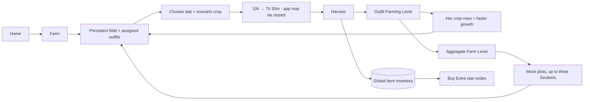

# Stable Farm

> **Status: complete through M026, rebalanced by D234 and D237.** The rules/catalog, synced Farm and item-ledger runtime,
> Home/Sections/field/worker/crop screens, global Item inventory and the Extra stats bridge (D235) are implemented.

> **New definition in review (2026-10-08):** the [Farm production/cooking rework](farm-kitchen-rework.md) proposes
> five fully open districts, per-outfit expertise, recipes and shared-block Extra Stats. It is not implemented;
> the shipped rules below remain current until that definition is approved and its cutover releases.

Stable Farm is a global, asynchronous account activity reached from Home. It begins with one plot and grows, plot by plot,
into three **Farm Sections** of six as owned Uma **outfits** learn to farm. A crop grows while the app is closed, harvesting
adds produce to the global Item inventory, and the worker earns an outfit-specific Farming Level that opens the next
scenario's crops every ten levels and grows her crops faster. Every outfit level feeds the account's aggregate Farm
Level, which opens plots. Neither level has a cap, though the field stops at 18 plots: it is meant to run for many months,
with many outfits levelling in parallel (D203–D208; D234 supersedes the six-plot field, the Lv20 cap, the Farm Level crop
gate and fixed timers; D237 sets three Sections and the 10h → 7h 30m timers).

The design is informed by [Farming game research](../research/farming-games.md). Although the player may call it a
minigame, it is intentionally **not** a ticketed `MinigameHost` run: there is no match, seed, journal, score, win or loss.
It is a synced account system whose state advances from stored timestamps.

## Place in the game



- Farm progress is **account-wide**, not attached to the featured Uma or an active scenario.
- It never spends or pays Training Tickets and never grants Uma EXP, Training EXP, card stars, badges or race facts.
- Outfit Farming Level and aggregate Farm Level are visible only inside the Farm shell. They do not join the Stable sort,
  Uma profile or global account header; the Home Farm card may show the Farm Level and next Farm unlock.
- Produce is the Farm's racing bridge: a scenario's crops buy its [Extra stat](constellations.md#extra-stats) nodes (D235).
  Inventory remains global and the Farm loop itself never depends on the featured Uma or active scenario.

## The field

Plots are numbered slots, `plot-1` … `plot-18`, not free-positioned objects. Every six make a **Farm Section**: plots 1–6
are Section 1, 7–12 Section 2 and 13–18 Section 3, the whole Farm (D237), so one Section is exactly the 2 × 3 field a phone
shows at once. **Only plot 1 starts unlocked**; Farm Level opens the rest in order, filling each Section before the next
(D234). A plot is one of five states:

| State | Stored data | Player action |
|---|---|---|
| **Locked** | nothing; the lock is derived from Farm Level | Inspect the level requirement |
| **Unassigned** | unlocked plot id, no worker | Assign an owned outfit |
| **Idle** | plot id and assigned outfit template id; optional last crop id | Plant a crop or change worker |
| **Growing** | assigned outfit, cycle id, crop id, `plantedAt`, `readyAt` | Inspect; no mid-cycle edits |
| **Ready** | the same growing record; readiness is derived from `now >= readyAt` | Harvest |

Ready is not written by a timer. The saved state remains `growing`; the domain and UI derive Ready from the deadline.
Nothing withers and a ready plot waits indefinitely.

### Assignment rules

- A worker is an **owned outfit**, keyed by Uma `templateId`. Two owned outfits of the same character are two farmers,
  have separate Farming Levels, and may work separate plots at the same time (D207).
- One outfit may occupy at most one plot. Assignment belongs to the plot and persists across harvests, reloads, visits and
  devices until the player deliberately changes it.
- Entering Farm never opens a picker and never asks for a featured Uma. It lands on the saved field. The shared Farm
  outfit picker opens from an unlocked plot or a Farm management menu and shows outfits, not collapsed characters.
- A worker may be changed only while her plot is Idle. A growing or Ready cycle freezes its outfit and crop; there is no
  cancel or swap, which prevents timer resets and ambiguous XP ownership.
- Planting requires only the outfit's Farming Level to have opened the crop's scenario row (D234). The confirmation shows
  the outfit, crop, destination scenario, Section and plot, how long it will take and the exact ready time.
- Seeds are unlimited and free. Time, plot capacity and worker progression are the pacing constraints.

### Cycle and harvest

| Rule | Value |
|---|---|
| Growth time | Her **newest** row: **10 hours** when it opens, **15 minutes less** for each of her next ten levels. Every **older** row: **7h 30m** |
| Yield | **1 item** |
| Worker reward | **12 Farming XP** |
| Randomness | none |

Growth time belongs to the worker and the crop row together (D234, D237). Her first row (scenario 1) opens at Farming Lv1,
so she grows it in 10h at Lv1, 9h 45m at Lv2 … 8h at Lv9. At Lv10 scenario 2 opens at 10h, and scenario 1 becomes an
older row at 7h 30m; scenario 2 reaches 7h 45m at Lv19 and 7h 30m at Lv20, when scenario 3 opens. Scenario `t` opens at
Lv`10 × (t − 1)`; scenario 14, with no row after it, reaches 7h 30m at Lv140. Every level therefore pays something: it
speeds up her newest row, or opens the next one. Older crops at 7h 30m are three harvests a day for someone who checks in
morning, afternoon and night.

The cycle id is deterministic and monotonic per plot: `farm:<plotId>:<attempt>`. Planting writes `plantedAt` and
`readyAt = plantedAt + growth time` once, from her level at that moment; a cycle carries one of the eleven allowed
durations (10h, 9h 45m … 7h 30m), or one of D234's (12h, 11h 36m … 8h) on a crop planted before D237, which finishes on
its own deadline. Reloading, going offline, changing time zone or opening on another route never rolls or
recomputes the deadline. The one exception is a playtesting shortcut: Settings → Playtesting → **Farm: growing crops −30 min** moves
every crop still growing 30 minutes earlier, its `plantedAt` and `readyAt` together, so the cycle keeps an allowed
duration and syncs like any other Farm change (D238).

Harvest is one atomic transaction:

1. re-read and parse the Farm, worker and inventory state;
2. require the plot's same cycle id and `now >= readyAt`;
3. append one idempotency record keyed by the cycle id;
4. add one crop item to its global stack;
5. add 12 Farming XP to the assigned outfit, applying every outfit level crossed and recomputing Farm Level;
6. clear the crop/cycle but retain the outfit assignment, returning the plot to Idle;
7. publish the Zustand view only after the transaction succeeds.

A retry of the same cycle reconstructs the already-committed result and never pays the item or XP twice. A clock moved
backward leaves the crop growing longer; a clock moved forward can make it ready. The app is a trusted personal client,
so no server clock or online check is introduced.

## Outfit Farming Level and aggregate Farm Level

**Outfit Farming Level** is per owned Uma template and **has no cap** (D234). It has no relationship to Uma Level,
Training Level, scenario progress, aptitudes, cards, races or badges. Only a completed harvest earns Farming XP. Every
newly owned outfit starts at Farming Level 1 with 0 XP; merely acquiring another outfit does not advance the Farm.

Farming Level is the **vertical** track, and it is linear (D234): every level costs the same 24 XP, two harvests, and a
new scenario's crops open every ten levels.

```
xpToNext(L) = 24
```

| Opens | At Farming Level | Harvests from Lv1 | Days at two harvests a day |
|---|---:|---:|---:|
| Scenario 1 crops | 1 | 0 | 0 |
| Scenario 2 crops | 10 | 18 | 9 |
| Scenario 5 crops | 40 | 78 | 39 |
| Scenario 14 crops | 130 | 258 | 129 |

Her Farming Level does two things: it opens a scenario's crop row every tenth level, and it grows each open row faster
for ten levels (above). The ladder simply continues when a new scenario adds a crop row. Excess XP applies across level
boundaries.

The account's **Farm Level** is derived, never earned from a separate XP bar, and has no cap:

```
farmLevel = 1 + Σ over owned outfits (outfitFarmingLevel − 1)
```

Every outfit level after its free baseline advances Farm Level once. Different outfits of the same character count
separately. Farm Level is the **horizontal** track, and the one that steepens (D234). It does one thing: it opens plots,
in order, and each plot costs twice the square of the plots already open more than the one before:

```
required(1) = 1;   required(n) = required(n − 1) + 2 × (n − 1)²
```

| Section | Plots open at Farm Level |
|---|---|
| 1 | 1 · 3 · 11 · 29 · 61 · 111 |
| 2 | 183 · 281 · 409 · 571 · 771 · 1,013 |
| 3 | 1,301 · 1,639 · 2,031 · 2,481 · 2,993 · 3,571 |

Three Sections are the whole Farm (D237). The last plot, at Farm Level 3,571, is 3,570 outfit levels past the free first
ones: **24 outfits at Farming Lv150** (37 at Lv100), or 7,140 harvests however they are split, since every level is two
harvests. Farm Level keeps counting after that, but opens nothing more.

Since every harvest is worth the same Farm Level, Farm Level grows with the number of working plots. Each plot adds a
worker, but the next plot's cost grows faster than that, so every wait is a little longer than the last. Later Sections
need many outfits levelled very high, and new outfits start at Lv1 on scenario 1 crops at ten hours, so the field
always mixes veterans and newcomers.

`pnpm sim:farm` measures this with a synthetic stable of 30 outfits gaining one a week. At each check-in it harvests
whatever is ready, puts a free outfit on any empty open plot, and plants the worker's fastest crop (an older row at
7h 30m, once she has two):

| Check-ins | Section 1 full | Section 2 full | Section 3 full (the Farm) | Best worker opens scenario 14 |
|---|---:|---:|---:|---:|
| Five times a day | day 25 | day 96 | day 213 | day 88 |
| Three times a day, 8h apart | day 30 | day 102 | day 220 | day 91 |
| Twice a day | day 30 | day 132 | day 306 | day 129 |
| Once a day | day 61 | day 265 | day 613 | day 258 |

Twice a day every crop is one harvest a check-in, so the timers change nothing there; three check-ins 8 hours apart turn
every older-row crop into three harvests a day and fill the Farm about three months sooner. Twice a day, the waits between
plots run 2, 4, 6 … days in Section 1 and about a month each late in Section 3. The sim fails if twice-daily play stops
filling Section 1 in about a month, Section 2 in about four or Section 3 in about ten, or if a wait ever gets shorter than
the one before.

## Crop catalog

Each of the fourteen scenario tiers has one crop for each stat: **70 item definitions**. They are ordinary fruit and
vegetable names authored for Uma Racer, not imported source rows. A new scenario adds a row of five. Every item
definition contains:

```ts
interface FarmCropDefinition {
  id: `produce:t${string}:${'speed' | 'stamina' | 'power' | 'guts' | 'wit'}`
  name: string
  stat: 'speed' | 'stamina' | 'power' | 'guts' | 'wit'
  scenarioTier: number
  outfitLevelRequired: number   // 1, then 10 × (tier − 1)
  yield: 1
  farmingExp: 12
}
```

Each scenario crop row has one gate, the worker's own Farming Level (D234); growth time follows from how far past it
she is:

| Scenario tier | 1 | 2 | 3 | 4 | 5 | 6 | 7 | 8 | 9 | 10 | 11 | 12 | 13 | 14 |
|---|---:|---:|---:|---:|---:|---:|---:|---:|---:|---:|---:|---:|---:|---:|
| Opens at Farming Level | 1 | 10 | 20 | 30 | 40 | 50 | 60 | 70 | 80 | 90 | 100 | 110 | 120 | 130 |
| 8 hours from Farming Level | 11 | 20 | 30 | 40 | 50 | 60 | 70 | 80 | 90 | 100 | 110 | 120 | 130 | 140 |

The launch names are deliberately generic and checked in; tests may use smaller invented fixtures.

| Tier | Speed | Stamina | Power | Guts | Wit |
|---:|---|---|---|---|---|
| 1 | Carrot | Sweet Potato | Corn | Chili Pepper | Blueberry |
| 2 | Radish | Yam | Potato | Bell Pepper | Strawberry |
| 3 | Snap Pea | Taro | Daikon | Shishito Pepper | Tomato |
| 4 | Cucumber | Cassava | Onion | Jalapeño | Grape |
| 5 | Asparagus | Beet | Garlic | Ginger | Apple |
| 6 | Green Bean | Turnip | Leek | Mustard Greens | Pear |
| 7 | Zucchini | Parsnip | Broccoli | Horseradish | Peach |
| 8 | Okra | Pumpkin | Cauliflower | Wasabi Root | Plum |
| 9 | Celery | Butternut Squash | Cabbage | Red Pepper | Cherry |
| 10 | Scallion | Acorn Squash | Eggplant | Radicchio | Persimmon |
| 11 | Bamboo Shoot | Plantain | Artichoke | Bitter Melon | Fig |
| 12 | Fennel | Breadfruit | Avocado | Turmeric Root | Pomegranate |
| 13 | Starfruit | Lotus Root | Jackfruit | Habanero | Kiwi |
| 14 | Snow Pea | Winter Melon | Romanesco | Scotch Bonnet | Dragon Fruit |

The stat glyph and text are always shown; crop art and color are supporting cues only. The Crop Catalog shows the
Farming Level a row needs, or how long the chosen worker takes to grow it. A crop can be grown even if no racing Uma
has reached its destination scenario, provided the assigned outfit has opened its row. Stockpiling for a future Uma is
allowed.

## Global Item inventory

**D287–D290 preservation is enabled:** active bank2 accounts retain `training:level-up-ticket` as Legacy Universal
CL stock; save16's retired EXP bank is zero and no ongoing mint remains. Only the final protected account conversion
adds pooled unapplied EXP once, bypassing material debt. Nonnegative global Items and separate negative balances
stay distinct. Farm plots/workers/crops and purchases are untouched.
[Versioned migration/receipt](../technical/uma-puzzles-implementation.md#t115-implemented-preservation-v2-d287).

T114/D283 extends the **same** global catalogue/view with `constellation` materials: four source-style tickets per
registered scenario (currently56), ordered by registry then Front/Pace/Late/End. The shared view joins ordinary
nonnegative Item stacks; owned/all and scenario/style facets do not create a Puzzle-local inventory. Unknown saved
stacks have safe read-only detail links. After active cutover, Farm Items and the Puzzle Items shortcut reuse the
same material renderer; stock and the nonpositive Constellation repayment bank are shown separately. Ticket details
link to the earning chapter, exchange and eligible owned recipients. Preserved universals are labelled **Legacy
Universal CL Ticket**, distinct from daily Training Tickets and Inspiration tokens. Material operations require an
active preserved bank; produce/Inspiration keep their own unchanged transactions.

The inventory is an account system, not a field bag. `produce` contains Farm crops; `training` retains one finite
**Legacy Universal CL Ticket** (`training:level-up-ticket`). Its former Training EXP mint is historical (D212),
not active farming/training gameplay. `constellation` contains scenario/style Puzzle materials.

```ts
interface InventoryStack {
  itemId: string
  quantity: number        // non-negative safe integer
  version: number
  updatedAt: number
}

interface ItemLedgerEntry {
  id: string              // operation id; farm harvest uses the cycle id
  itemId: string
  delta: number           // non-zero safe integer
  reason: 'farm-harvest' | 'extra-stat-unlock' | 'constellation-produce' | 'exp-bank' | 'training-level-up'
  source:
    | { kind: 'farm-harvest'; plotId: string; cycleId: string; templateId: string; farmingExp: 12 }
    | { kind: 'extra-stat-unlock'; umaId: string; tier: number; nodeId: string }   // −1…−4, id extra:<umaId>:<tier>:<nodeId>
    | { kind: 'constellation-produce'; umaId: string; tier: number; nodeId: string; revision: number } // pre-v12 history
    | { kind: 'spark-run'; runId: string }            // exp-bank: a run past TL10, id exp-bank:<runId>
    | { kind: 'bank-settle' }                         // exp-bank: startup settling the migrated bank
    | { kind: 'level-up'; umaId: string; tier: number; fromLevel: number; fromExp: number } // a spend (D213)
  createdAt: number
}
```

- One synced stack row per item keeps reads bounded; no stack has a capacity.
- An append-only item ledger makes every add/spend auditable and idempotent. Farm evidence also names its outfit worker
  and XP, so stack quantity and outfit progress are projections rather than the only evidence.
- Farm, stack, item-ledger row and outbox entries commit together in Dexie.
- Constellation consumption re-reads the Uma, stack and revision-keyed evidence, then commits the assignment, `-1`
  movement, stack, badge reconciliation and outbox together. Exact retries do not spend again; a stale screen reloads.
- Cloud sync uses the existing versioned-entity/first-write-wins-log rules. Reconciliation can rebuild a stack and worker
  XP from unique item-ledger evidence, clear a cycle whose harvest evidence already exists, and advance each plot's
  attempt floor after a two-device conflict; it never invents a harvest.
- The Item inventory route opens with a **Training** panel (Level-Up Tickets owned and the Training EXP bank as
  `850 / 1,250`), then groups produce by stat and filters by destination scenario. Zero produce stacks are hidden by
  default but catalog completion can show them as silhouettes.

## Screen contract

### Entry, shell and routes

- Home gains a **Farm** card with Farm Level, ready/working/open plots, the next deadline and the next plot unlock.
  Tapping it opens the lazy `/farm` route directly on the saved Sections—never an Uma-selection interstitial.
- Farm is a nested full-screen account activity with Back, **How it works**, Farm Level (one number) and a compact
  internal navigation: **Field · Workers · Crops · Items**. It does not add a sixth bottom tab.
- `/farm`, `/farm/section/<n>`, `/farm/workers`, `/farm/crops` and `/farm/items` share one Farm shell and preserve scroll
  on return. Field covers the Section list and every Section. Item inventory remains global in data scope even though
  Farm is its first home.

### Sections at 390 × 844

- `/farm` lists every Section with an open plot, then the next Section, locked, with the Farm Level that opens it (D234);
  once Section 3 has a plot open there is no next Section, and once its last plot opens **Next** reads "All 18 plots are
  open" (D237).
- Each Section card is a quick preview: its name, a status line (`1 ready · 2 growing · 1 idle · 1 empty`), six small slots
  showing each worker's standing chibi with the crop growing under her, a **READY** band on a ready slot and a lock on a
  locked one, and when its next crop is ready. Readiness is also in the text, never color alone.
- Tapping an open Section opens its field. A locked Section is not a link. Below the list, **Next** names the next plot
  and its Farm Level.

### A Section's field at 390 × 844

- The Section's six plot positions render as a 2 × 3 grid, numbered Plot 1–6 within the Section. Locked plots name
  their Farm Level; every unlocked panel has a minimum 44 pt action target. A Back row returns to the Section list and
  repeats the Section's status; a Section that is not open, or an unknown number, redirects to the list.
- Unassigned: soil illustration, **Assign outfit** and no fake worker. This appears only on a newly unlocked plot or after
  the player explicitly removes an idle assignment.
- Idle: the persistent outfit chibi and level, the last crop as a suggestion, **Plant**, and a secondary **Change** action.
- Growing: the worker's standing chibi, crop name, stat glyph, destination scenario, accessible progress meter and the
  rounded remaining time. The exact ready time is in the detail sheet.
- Ready: brighter border, `Ready` text and **Harvest** in the thumb zone. Readiness is never communicated by color alone.
- **Harvest** returns to the same assigned Idle plot. **Plant again** may preselect its last crop but is always an explicit
  confirmation; there is no auto-repeat.
- Assign/Change opens the shared Farm outfit picker. It lists every owned outfit separately, shows Farming Level/progress,
  Uma Level and current plot, disables outfits already working elsewhere, and returns to the calling Farm menu.
- Plant opens the crop picker directly for the assigned outfit, on her newest open row. It filters by stat/scenario,
  marks a row she has not opened with its Farming Level, and shows `Grows in 10h 48m` on every crop she can plant.
- **Workers** is the complete outfit roster, grouped Working / Available and sorted within each group by **Farming Level
  descending, then Uma Level descending**, then character/outfit name and id for deterministic ties. The shared assignment
  picker and crop-access worker picker use this same order, and show both levels so the priority is legible.
  Each card shows her Section and plot, Farming XP to the next level, her newest row and how fast she grows it, and the
  row her next tenth level opens. **Crops** is the 70-item catalog with scenario/stat filters, each row's Farming Level
  or growth time for a chosen worker, and stock. Both reuse the same outfit picker rather than creating a selected-Uma
  state for the whole Farm.
- The harvest moment names any Farming Level, the new Farm Level and every plot it opened (`Section 2 · Plot 1 opened`).

The route reuses Paddock panels, `TypeIcon`, `Meter`, `BottomSheet`, safe-area utilities and private standing chibis. Crop
marks are original code-native drawings; emoji and checked-in original-game images are prohibited. Motion is transform
and opacity only, reduced-motion has an instant equivalent, and a one-minute presentation tick updates labels without
writing the save.

## Extra stats bridge

The Farm's crops buy the [Extra stats](constellations.md#extra-stats) grid of every trained unit (D235; it replaced
D205's Produce nodes).

- Each scenario's grid has four nodes of each stat. A stat's next node costs that stat's crop for the scenario: 1, 2, 3
  and 4 of them, so 10 for a full row and 50 for a unit's grid. Crops are consumed for good.
- Any six bought nodes can be on, each paying 40 raw points to its stat. Switching is free; buying is the only spend.
- A purchase commits the Uma, the crop stack, its `-cost` evidence `extra:{umaId}:{tier}:{nodeId}` and outbox in one
  transaction. A retry finds its evidence; a stale screen that targets a node already bought reloads the grid.
- Every new Uma starts each scenario with an empty grid, and every scenario is its own sink: 50 crops a unit, from each
  scenario's own crop row, which is what keeps the Farm worth growing for years.
- Older `constellation-produce` evidence stays valid history. Save v12 turned each filled Produce node into a bought,
  active node of its stat, free, four at most a stat.

## Persistence boundary

M025 added synced Farm state, inventory stacks and item-ledger rows through the normal local-first save. It does not put
timers in the profile, an Uma row, local preferences or `minigameRuns`.

The production `FarmHost` lazily creates `farm/main` on first Farm access and exposes optimistic command revisions so a
stale screen cannot overwrite a newer local command while the cloud entity version is still awaiting sync. Assignment,
plant and harvest re-read Farm and ownership inside Dexie transactions. Harvest retries resolve from the cycle-keyed
evidence row, while evidence reconciliation repairs item quantities, outfit XP, attempt floors and a harvested cycle
resurrected by a sync conflict. An already-correct projection performs no write.

M026 added no Farm fields; its Produce nodes lived on the Uma rows (save v9–v11). Save v12 (D235) replaces them with each
unit's `extraStats` grid. A purchase transaction spans Uma, item stack, item evidence, badge/flair projections and all
outbox markers; Zustand publishes only after commit. Its evidence id is `extra:{umaId}:{tier}:{nodeId}`.

```text
players/{uid}/farm/main              schema, six plot slots, persistent outfit assignments, outfit XP/levels, attempts, version
players/{uid}/items/{itemId}         current global stack quantity, version
players/{uid}/itemLedger/{id}        append-only item movement evidence
```

The Farm row is bounded: one plot record for each plot that differs from an empty, never-planted one, in plot order, and
one compact worker-progress record per owned outfit. Farm Level and plot locks are derived from those records, not
stored as another mutable counter. Parsers cap arrays, ids, timestamps, XP and attempts; their bounds (plot 600,
Farming Lv99,999) are far past anything reachable and are not design caps. Unknown/future schema is a visible save
error; corrupt rows are never reset.

**Farm schema v2 (D234).** v1 stored exactly six plots and Farming Levels 1–20 on the old curve. v2 stores plots
sparsely as `plot-<n>`, accepts any of the eleven growth durations and uncapped levels. Moving a v1 Farm to v2 re-levels
each worker from her lifetime Farming XP (every harvest is still 12 XP, so this equals replaying her harvest evidence),
which only ever raises her, and drops never-planted plots. A growing 12-hour cycle keeps its deadline. Dexie v20 moves
the local row once and queues it for upload; a v1 row pulled from the server moves the same way and is re-uploaded. The
API accepts both shapes, so an older build can still sync, and the newer schema always wins a conflict.

## Acceptance targets

- Planting, reload and harvest reproduce the same worker, crop and deadline online or offline.
- A harvest writes exactly one item and one XP award; retry is a no-op with the same result.
- A new account opens plot 1 only; plot assignment persists after harvest and across reloads. Farm never asks for an Uma
  merely because the route opened.
- Many different outfits may work; the same outfit cannot occupy two plots even through stale screens, while two outfits
  of the same character remain independent valid workers.
- An outfit reaches Farming Lv10 after 18 harvests and opens scenario 14's row at Lv130 after 258. Plots open at
  1 / 3 / 11 / 29 / 61 / 111, then 183 for Section 2, and stop at plot 18 (Farm Lv3,571). A newest row steps from 10h
  in 15-minute steps over the ten levels after it opens, and an older row is 7h 30m. All of this is pinned by tests, and
  the pacing envelope by `pnpm sim:farm`.
- Farm state syncs to another device through the existing save flow; a running crop is not rerolled or shortened.
- An Extra stat purchase spends exactly its 1–4 crops and writes one movement; retry is idempotent and stale screens do
  not spend. Switching nodes spends nothing.
- The Home badge, field, pickers, workers and inventory are usable at 390 × 844 and 375 × 667 with 44 pt targets,
  VoiceOver labels, reduced motion and no startup-bundle regression over 180 KB gzip.
- Checked-in fixtures are small and synthetic. No original-game rows or images enter git.

## Deliberately later

- decoration or free placement;
- batch **Harvest all** / **Plant again** per Section, the obvious next step once several Sections are open;
- worker specialties, yield bonuses or per-crop mastery;
- watering, weather, seasons, fertilizer, quality, failure or withering;
- auto-repeat, batch planting, push notifications or background tasks;
- cooking, crafting, selling, exchanges or any second currency;
- farm badges, titles, trainer achievements or race effects.
