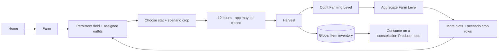

# Stable Farm

> **Status: complete through M026.** The rules/catalog, synced Farm and item-ledger runtime, Home/field/worker/crop
> screens, global Item inventory and constellation Produce consumption are implemented.

Stable Farm is a global, asynchronous account activity reached from Home. It begins with one plot and grows into a
six-plot field as owned Uma **outfits** learn to farm. A crop grows while the app is closed, harvesting adds produce to
the global Item inventory, the worker earns an outfit-specific Farming Level, and every outfit level feeds the account's
aggregate Farm Level (D203–D208; D206–D208 supersede the initial fixed-field/character drafts).

The design is informed by [Farming game research](../research/farming-games.md). Although the player may call it a
minigame, it is intentionally **not** a ticketed `MinigameHost` run: there is no match, seed, journal, score, win or loss.
It is a synced account system whose state advances from stored timestamps.

## Place in the game



- Farm progress is **account-wide**, not attached to the featured Uma or an active scenario.
- It never spends or pays Training Tickets and never grants Uma EXP, Training EXP, card stars, badges or race facts.
- Outfit Farming Level and aggregate Farm Level are visible only inside the Farm shell. They do not join the Stable sort,
  Uma profile or global account header; the Home Farm card may show the Farm Level and next Farm unlock.
- Produce is the Farm's racing bridge: a constellation consumes one matching-scenario crop for a first fill or replacement.
  Inventory remains global and the Farm loop itself never depends on the featured Uma or active scenario.

## The field

There are six stable slots, `plot-1` through `plot-6`, not free-positioned objects. **Only plot 1 starts unlocked**;
Farm Level opens the other five (D206–D208). A plot is one of five states:

| State | Stored data | Player action |
|---|---|---|
| **Locked** | plot id only; lock is derived from Farm Level | Inspect the level requirement |
| **Unassigned** | unlocked plot id, no worker | Assign an owned outfit |
| **Idle** | plot id and assigned outfit template id; optional last crop id | Plant a crop or change worker |
| **Growing** | assigned outfit, cycle id, crop id, `plantedAt`, `readyAt` | Inspect; no mid-cycle edits |
| **Ready** | the same growing record; readiness is derived from `now >= readyAt` | Harvest |

Ready is not written by a timer. The saved state remains `growing`; the domain and UI derive Ready from the deadline.
Nothing withers and a ready plot waits indefinitely.

### Assignment rules

- A worker is an **owned outfit**, keyed by Uma `templateId`. Two owned outfits of the same character are two farmers,
  have separate Farming Levels, and may work separate plots at the same time (D207).
- One outfit may occupy at most one plot. Assignment belongs to the plot and persists across harvests, reloads, visits and
  devices until the player deliberately changes it.
- Entering Farm never opens a picker and never asks for a featured Uma. It lands on the saved field. The shared Farm
  outfit picker opens from an unlocked plot or a Farm management menu and shows outfits, not collapsed characters.
- A worker may be changed only while her plot is Idle. A growing or Ready cycle freezes its outfit and crop; there is no
  cancel or swap, which prevents timer resets and ambiguous XP ownership.
- Planting requires both the outfit's Farming Level and the aggregate Farm Level to meet the crop's two requirements. The
  confirmation shows the outfit, crop, destination scenario and exact ready time.
- Seeds are unlimited and free. Time, plot capacity and worker progression are the pacing constraints.

### Cycle and harvest

Every crop uses the same first-release values:

| Rule | Value |
|---|---|
| Growth time | **12 hours** |
| Yield | **1 item** |
| Worker reward | **12 Farming XP** |
| Randomness | none |

The cycle id is deterministic and monotonic per plot: `farm:<plotId>:<attempt>`. Planting writes `plantedAt` and
`readyAt = plantedAt + 12 h` once. Reloading, going offline, changing time zone or opening on another route never rolls
or recomputes the deadline.

Harvest is one atomic transaction:

1. re-read and parse the Farm, worker and inventory state;
2. require the plot's same cycle id and `now >= readyAt`;
3. append one idempotency record keyed by the cycle id;
4. add one crop item to its global stack;
5. add 12 Farming XP to the assigned outfit, applying every outfit level crossed and recomputing Farm Level;
6. clear the crop/cycle but retain the outfit assignment, returning the plot to Idle;
7. publish the Zustand view only after the transaction succeeds.

A retry of the same cycle reconstructs the already-committed result and never pays the item or XP twice. A clock moved
backward leaves the crop growing longer; a clock moved forward can make it ready. The app is a trusted personal client,
so no server clock or online check is introduced.

## Outfit Farming Level and aggregate Farm Level

**Outfit Farming Level** is per owned Uma template, from **1 to 20**. It has no relationship to Uma Level, Training Level,
scenario progress, aptitudes, cards, races or badges. Only a completed harvest earns Farming XP. Every newly owned outfit
starts at Farming Level 1 with 0 XP; merely acquiring another outfit does not advance the Farm.

For current level `L` from 1 through 19:

```
xpToNext(L) = 48 + 12 × floor((L − 1) / 4)
```

| Current levels | XP to next | Perfect 12 h cycles | Active time per level |
|---|---:|---:|---:|
| 1–4 | 48 | 4 | 2 days |
| 5–8 | 60 | 5 | 2.5 days |
| 9–12 | 72 | 6 | 3 days |
| 13–16 | 84 | 7 | 3.5 days |
| 17–19 | 96 | 8 | 4 days |

A continuously assigned outfit reaches level 20 after **112 harvests / 56 days** at perfect cadence. Unlocked plots let
several outfits advance in parallel. Excess XP applies across level boundaries and XP at level 20 is clamped to zero
remaining; there is no outfit prestige loop.

The account's **Farm Level** is derived, never earned from a separate XP bar:

```
farmLevel = 1 + Σ over owned outfits (outfitFarmingLevel − 1)
```

Every outfit level after its free baseline therefore advances Farm Level once. A single outfit can add at most 19 Farm
Levels, so later field and crop unlocks require raising multiple outfits. Different outfits of the same character count
separately. Farm Level has no artificial cap; once current unlocks end, the number remains an account record ready for
later Farm content.

Farm Level opens plots on this first balance ladder:

| Plot | 1 | 2 | 3 | 4 | 5 | 6 |
|---|---:|---:|---:|---:|---:|---:|
| Farm Level required | 1 | 2 | 6 | 13 | 27 | 42 |
| Ideal twice-daily spread target | start | day 2 | day 6 | day 12 | day 20 | day 28 |

The day row is a tuning target from an ideal policy that gives every available plot two harvests a day and spreads work
across low-level owned outfits. It is not a login streak or promise. `pnpm sim:farm` must measure first/median unlocks for
focused, even-spread and casual one-harvest-per-day policies before a threshold changes.

Outfit Farming Level and Farm Level change **only crop/field eligibility**. Neither shortens a timer nor increases yield,
so a favorite does not become the objectively correct worker forever, and moving several outfits forward is valuable.

## Crop catalog

Each of the fourteen scenario tiers has one crop for each stat: **70 item definitions**. They are ordinary fruit and
vegetable names authored for Uma Racer, not imported source rows. Every item definition contains:

```ts
interface FarmCropDefinition {
  id: `produce:t${string}:${'speed' | 'stamina' | 'power' | 'guts' | 'wit'}`
  name: string
  stat: 'speed' | 'stamina' | 'power' | 'guts' | 'wit'
  scenarioTier: number
  outfitLevelRequired: number
  farmLevelRequired: number
  growthHours: 12
  yield: 1
  farmingExp: 12
}
```

Each scenario crop row has two gates. The Farm Level opens it in the account's Crop Catalog; the assigned outfit's level
proves that farmer can grow it:

| Scenario tier | 1 | 2 | 3 | 4 | 5 | 6 | 7 | 8 | 9 | 10 | 11 | 12 | 13 | 14 |
|---|---:|---:|---:|---:|---:|---:|---:|---:|---:|---:|---:|---:|---:|---:|
| Outfit Farming Level | 1 | 2 | 4 | 5 | 7 | 8 | 10 | 11 | 13 | 14 | 16 | 17 | 19 | 20 |
| Aggregate Farm Level | 1 | 2 | 4 | 7 | 11 | 16 | 22 | 29 | 37 | 46 | 56 | 67 | 79 | 92 |

The launch names are deliberately generic and checked in; tests may use smaller invented fixtures.

| Tier | Speed | Stamina | Power | Guts | Wit |
|---:|---|---|---|---|---|
| 1 | Carrot | Sweet Potato | Corn | Chili Pepper | Blueberry |
| 2 | Radish | Yam | Potato | Bell Pepper | Strawberry |
| 3 | Snap Pea | Taro | Daikon | Shishito Pepper | Tomato |
| 4 | Cucumber | Cassava | Onion | Jalapeño | Grape |
| 5 | Asparagus | Beet | Garlic | Ginger | Apple |
| 6 | Green Bean | Turnip | Leek | Mustard Greens | Pear |
| 7 | Zucchini | Parsnip | Broccoli | Horseradish | Peach |
| 8 | Okra | Pumpkin | Cauliflower | Wasabi Root | Plum |
| 9 | Celery | Butternut Squash | Cabbage | Red Pepper | Cherry |
| 10 | Scallion | Acorn Squash | Eggplant | Radicchio | Persimmon |
| 11 | Bamboo Shoot | Plantain | Artichoke | Bitter Melon | Fig |
| 12 | Fennel | Breadfruit | Avocado | Turmeric Root | Pomegranate |
| 13 | Starfruit | Lotus Root | Jackfruit | Habanero | Kiwi |
| 14 | Snow Pea | Winter Melon | Romanesco | Scotch Bonnet | Dragon Fruit |

The stat glyph and text are always shown; crop art and color are supporting cues only. The Crop Catalog shows both lock
reasons. A crop can be grown even if no racing Uma has reached its destination scenario, provided the Farm and assigned
outfit meet the two farming requirements. Stockpiling for a future Uma is allowed.

## Global Item inventory

The inventory is an account system, not a field bag. Its first category is `produce`, but its shape must admit later
bounded item definitions without adding farm fields to the profile.

```ts
interface InventoryStack {
  itemId: string
  quantity: number        // non-negative safe integer
  version: number
  updatedAt: number
}

interface ItemLedgerEntry {
  id: string              // operation id; farm harvest uses the cycle id
  itemId: string
  delta: number           // non-zero safe integer
  reason: 'farm-harvest' | 'constellation-produce'
  source:
    | { kind: 'farm-harvest'; plotId: string; cycleId: string; templateId: string; farmingExp: 12 }
    | { kind: 'constellation-produce'; umaId: string; tier: number; nodeId: string; revision: number }
  createdAt: number
}
```

- One synced stack row per item keeps reads bounded; no stack has a capacity.
- An append-only item ledger makes every add/spend auditable and idempotent. Farm evidence also names its outfit worker
  and XP, so stack quantity and outfit progress are projections rather than the only evidence.
- Farm, stack, item-ledger row and outbox entries commit together in Dexie.
- Constellation consumption re-reads the Uma, stack and revision-keyed evidence, then commits the assignment, `-1`
  movement, stack, badge reconciliation and outbox together. Exact retries do not spend again; a stale screen reloads.
- Cloud sync uses the existing versioned-entity/first-write-wins-log rules. Reconciliation can rebuild a stack and worker
  XP from unique item-ledger evidence, clear a cycle whose harvest evidence already exists, and advance each plot's
  attempt floor after a two-device conflict; it never invents a harvest.
- The Item inventory route groups produce by stat and filters by destination scenario. Zero stacks are hidden by default
  but catalog completion can show them as silhouettes.

## Screen contract

### Entry, shell and routes

- Home gains a **Farm** card with Farm Level, `ready / unlocked plots`, the next deadline and the next field/crop unlock.
  Tapping it opens the lazy `/farm` route directly on the saved field—never an Uma-selection interstitial.
- Farm is a nested full-screen account activity with Back, **How it works**, Farm Level and a compact internal navigation:
  **Field · Workers · Crops · Items**. It does not add a sixth bottom tab.
- `/farm`, `/farm/workers`, `/farm/crops` and `/farm/items` share one Farm shell and preserve field scroll/selection on
  return. Item inventory remains global in data scope even though Farm is its first home.

### Field at 390 × 844

- All six plot positions render as a 2 × 3 grid so the farm's future shape is visible. Locked plots name their Farm Level;
  every unlocked panel has a minimum 44 pt action target.
- Unassigned: soil illustration, **Assign outfit** and no fake worker. This appears only on a newly unlocked plot or after
  the player explicitly removes an idle assignment.
- Idle: the persistent outfit chibi and level, the last crop as a suggestion, **Plant**, and a secondary **Change** action.
- Growing: the worker's standing chibi, crop name, stat glyph, destination scenario, accessible progress meter and the
  rounded remaining time. The exact ready time is in the detail sheet.
- Ready: brighter border, `Ready` text and **Harvest** in the thumb zone. Readiness is never communicated by color alone.
- **Harvest** returns to the same assigned Idle plot. **Plant again** may preselect its last crop but is always an explicit
  confirmation; there is no auto-repeat.
- Assign/Change opens the shared Farm outfit picker. It lists every owned outfit separately, shows Farming Level/progress and
  current plot, disables outfits already working elsewhere, and returns to the calling Farm menu.
- Plant opens the crop picker directly for the assigned outfit. It filters by stat/scenario and explains Farm-level and
  outfit-level locks separately.
- **Workers** is the complete outfit roster, grouped Working / Available and sorted by level then character/outfit name.
  **Crops** is the 70-item catalog with scenario/stat filters, both gates, stock and the next unlock. Both reuse the same
  outfit picker rather than creating a selected-Uma state for the whole Farm.

The route reuses Paddock panels, `TypeIcon`, `Meter`, `BottomSheet`, safe-area utilities and private standing chibis. Crop
marks are original code-native drawings; emoji and checked-in original-game images are prohibited. Motion is transform
and opacity only, reduced-motion has an instant equivalent, and a one-minute presentation tick updates labels without
writing the save.

## Constellation Produce bridge

The Farm's Produce is the stocked minor-stat choice in every constellation (D205). It shipped separately from M025
because it changed existing saved constellations and their interaction contract.

- Every current `stat` node becomes a **Produce node** with the same id, unlock order and **40 raw-point value**. The
  six-node 240-point pool and invariance tests do not change.
- Filling an empty Produce node selects one inventory crop whose `scenarioTier` matches that constellation and consumes
  exactly one. Its `stat` decides which stat receives the node's 40 points.
- Replacing a filled Produce node consumes one new crop and does not refund the old one. Clearing alone is not offered.
  A confirmation names the item, available quantity and exact stat delta.
- Existing filled stat nodes migrate to a `legacy-produce` assignment that keeps the same contribution without creating
  or consuming inventory. Once replaced, it follows the normal Produce rule. Save v9 and Dexie v15 perform this one-way
  migration while the API rejects an older Uma row over a newer one.
- Card and lineage reconfiguration remains free. The training screen filters the Item inventory to the active scenario;
  farming itself remains global.

## Persistence boundary

M025 added synced Farm state, inventory stacks and item-ledger rows through the normal local-first save. It does not put
timers in the profile, an Uma row, local preferences or `minigameRuns`.

The production `FarmHost` lazily creates `farm/main` on first Farm access and exposes optimistic command revisions so a
stale screen cannot overwrite a newer local command while the cloud entity version is still awaiting sync. Assignment,
plant and harvest re-read Farm and ownership inside Dexie transactions. Harvest retries resolve from the cycle-keyed
evidence row, while evidence reconciliation repairs item quantities, outfit XP, attempt floors and a harvested cycle
resurrected by a sync conflict. An already-correct projection performs no write.

M026 adds no Farm fields. Save v9 stores a crop id plus monotonic revision on each new Produce assignment, or a stat-only
legacy assignment for migrated builds. Dexie v15 migrates every v8 Uma row without touching `items` or `itemLedger`.
The consuming transaction spans Uma, item stack, item evidence, badge/flair projections and all outbox markers; Zustand
publishes only after commit. Its evidence id is `produce:{umaId}:{tier}:{nodeId}:{revision}`.

```text
players/{uid}/farm/main              schema, six plot slots, persistent outfit assignments, outfit XP/levels, attempts, version
players/{uid}/items/{itemId}         current global stack quantity, version
players/{uid}/itemLedger/{id}        append-only item movement evidence
```

The Farm row is bounded: six plot records and one compact worker-progress record per owned outfit. Farm Level and plot
locks are derived from those records, not stored as another mutable counter. Parsers cap
arrays, ids, timestamps, XP and attempts. Unknown/future schema is a visible save error; corrupt rows are never reset.

## Acceptance targets

- Planting, reload and harvest reproduce the same worker, crop and deadline online or offline.
- A harvest writes exactly one item and one XP award; retry is a no-op with the same result.
- A new account opens plot 1 only; plot assignment persists after harvest and across reloads. Farm never asks for an Uma
  merely because the route opened.
- Six different outfits may work; the same outfit cannot occupy two plots even through stale screens, while two outfits
  of the same character remain independent valid workers.
- An outfit reaches Farming Lv2 after four perfect cycles and Lv20 after 112. Aggregate Farm Level, plots at
  1 / 2 / 6 / 13 / 27 / 42 and both crop
  gates unlock exactly as documented and are covered by `pnpm sim:farm`.
- Farm state syncs to another device through the existing save flow; a running crop is not rerolled or shortened.
- A Produce fill/replacement spends exactly one crop, advances one node revision and writes one `-1` movement; retry is
  idempotent, stale screens do not spend, and migrated builds derive byte-for-byte the same racing state.
- The Home badge, field, pickers, workers and inventory are usable at 390 × 844 and 375 × 667 with 44 pt targets,
  VoiceOver labels, reduced motion and no startup-bundle regression over 180 KB gzip.
- Checked-in fixtures are small and synthetic. No original-game rows or images enter git.

## Deliberately later

- expansion beyond six plots, decoration or free placement;
- variable timers, worker specialties, yield/speed bonuses or crop mastery;
- watering, weather, seasons, fertilizer, quality, failure or withering;
- auto-repeat, batch planting, push notifications or background tasks;
- cooking, crafting, selling, exchanges or any second currency;
- farm badges, titles, trainer achievements or race effects.
