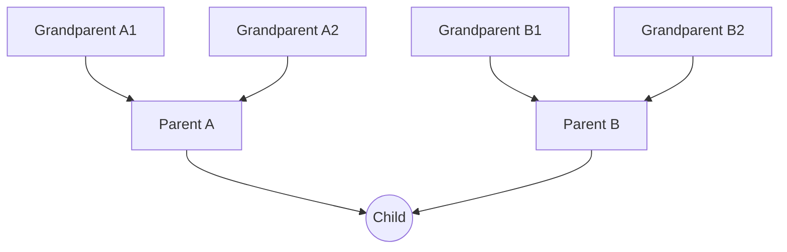
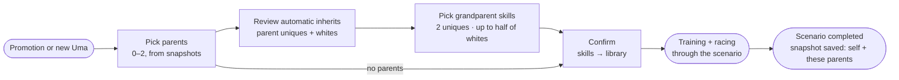

# Skills & Inheritance

> All numbers are **draft values for tuning**. Skill data (names, conditions, effects) is seeded from the
> original game ([data backlog](../research/data-backlog.md)).

## Skill kinds

| Kind | Source | Draft SP cost | Notes |
|---|---|---|---|
| **Unique** | The Uma's own template | Free, always equipped | The Uma's signature skill |
| **Inherited Unique** | Parents automatically · grandparents pick 2 | 200 | **Weaker version**: draft effect ×0.5, same trigger conditions |
| **Gold (rare)** | **Card hints only** ✅ | 250–350 | An upgraded white skill. **Never passed down as gold** |
| **White (normal)** | Card hints · inheritance | 90–180 | Includes white versions of golds received through inheritance |

## Skill Points (SP): loadout capacity

- SP is **trained like a stat**: every facility gives some (Wit gives the most), and cards add their **Skill Point Bonus**.
- Each scenario raises the **baseline SP cap**, and Training Level scales it like the stat caps:

  ```
  baselineSpCap(T) = 300 + 200 × (T − 1)        → tier 1: 300 · tier 5: 1,100 · tier 11: 2,300
  spCap(T, TL)     = baselineSpCap(T) × capMult(TL)   → 80% at TL1, 100% at TL10
  ```

- SP is **never spent**. The **total cost of equipped skills must be ≤ current SP**. Skills can be swapped freely.
- *(Rejected: SP as a currency spent to learn skills. Regrettable purchases conflict with fine-tuning.)*

## Skill library

The **skill library** is every skill an Uma has **unlocked in her current scenario**. The **loadout** is the subset she
has **equipped** for races, limited by her SP. Think of an inventory and equipped gear.

### Refreshed every scenario ✅

Skills are **per Uma, per scenario**. When an Uma starts a new scenario, her library is cleared back to her permanent skills,
and she earns the rest again through that scenario's inheritance and training:

| At scenario start, the library keeps | Cleared, to earn again |
|---|---|
| Her own unique skill | Card-hinted whites and golds |
| Awakening skills she has already unlocked | Inherited uniques and whites |

**Each scenario therefore runs: pick parents and inherit → train → race.** A single opening training turn unlocks racing
(see [Training — Opening training](training.md#opening-training)). What she can equip always reflects her *latest* deck and parents.

Stats, SP, level, card levels, and records **don't** reset. Only the skill library does.

> *Example:* in Grand Masters, Special Week's library holds her unique, 3 whites and 1 inherited unique from her parents,
> and, after training, 9 whites and 1 gold hinted by her cards. With 700 SP she equips her unique, the gold, and 3 whites for a
> Long race, then swaps 2 whites for Mile-focused ones before a Mile race. When she promotes to Project L'Arc, her library
> goes back to her unique, and her new deck and parents shape a new set.

### Sources

1. **Own unique skill:** permanent.
2. **Card training:** skill hints from cards present at the chosen facility (see [Training — Skill hints](training.md#skill-hints)).
   This is the **only** source of gold skills.
3. **Inheritance:** at the start of each scenario (below).
4. **Awakening skills** ✅: one unlocked permanently at each of the first four scenario completions.

Each skill in the library records its **origin** (`own-unique`, `card`, `inherited`, `awakening`), because only some origins pass down.
Every skill an Uma ever learns is also recorded in a **lifetime skill log** for badges and history.

### Link to parent snapshots

A snapshot is saved when a scenario is completed, so a parent passes on **the card skills from her last completed scenario**.
Retraining her with a different deck changes what she can pass down.

## Loadout

- The Uma equips any subset of her library, as long as the **total cost ≤ current SP**. The unique skill is free and always on.
- Swapping is free and instant, outside of races.
- **Loadout presets**, for example "Long / Front" and "Mile / Late". After a refresh, preset skills that haven't been re-earned yet show as unavailable.
- In the pre-race screen, the loadout shows which skills can trigger on this course.

---

## Inheritance

### Family tree

Like the original game: **2 parents**, each bringing **their own 2 parents** as grandparents.



**Parents are optional.** An Uma can start any scenario with 0, 1, or 2 parents, which makes the first
trainings possible before any Uma has finished a scenario ✅.

### Parent snapshots

A **parent snapshot** is a **fully frozen record** of an Uma and her parents, taken **when she completes a scenario**,
at promotion ✅. **Only the latest snapshot per Uma is kept.**

| Snapshot field | Content (all frozen at that moment) |
|---|---|
| `umaId` | The Uma this snapshot belongs to |
| `takenAt` | Date, and the scenario tier she completed |
| `self` | Her unique skill and her inheritable whites (plus her aptitudes, for pink sparks) |
| `parents[]` | The parents she trained with during that scenario, copied from the snapshots she picked: unique and inheritable whites. Empty if she trained without parents |

**When an Uma is picked as a parent, everything comes from her snapshot:**

- `self` is what she passes as a **parent**.
- `parents[]` become the child's **grandparents**.
- Nothing is read live. Skills she has learned since then **don't count until she is retrained**:
  completing another scenario replaces her snapshot with a fresh one ✅.
- Because snapshots are copies, the tree is always finite: nothing chains back through generations (A ← B ← A ← B …).

When picking parents, the **parent list** shows one entry per Uma with a snapshot: her icon, the tier she had
completed, her 2 parents' icons (the child's future grandparents), the snapshot's age, and how many **new** uniques
and whites she would give *this* child.

*Edge case: at the last available scenario there is no promotion. The snapshot is taken atomically with the race that
first reaches max level, and is replaced if a later app version adds a scenario and she eventually promotes.*

Only direct card-origin whites pass into `inheritableWhiteSkillIds`; a direct card-origin gold contributes its normalized
white counterpart. Inherited and awakening skills never pass as self-learned whites. The own unique contributes its
normalized inherited-unique counterpart when one exists. Missing referenced content blocks the snapshot instead of
silently shrinking it.

### Eligibility

- Up to 2 parents, and they must be **different characters**.
- A parent can't be the child herself or another outfit of the same character.
- **Only Umas with a snapshot** can be parents, which means they have completed at least 1 scenario.
- Parents are **locked for the whole scenario** once training starts.

### What passes down

| From | Unique skill | White skills |
|---|---|---|
| **Each parent** (up to 2) | **Automatic**: her Inherited Unique | **Automatic**: all of her inheritable whites |
| **Grandparents** (up to 4) | **Pick 2** of the eligible grandparent uniques | **Pick up to half** of the grandparent white pool, from any grandparent, even all from one |

Definitions:

- **Inheritable whites** of an Uma: the white skills she **learned from cards**, plus the **white version of every gold**
  she learned from cards. Gold skills are never passed as gold ✅.
- **Grandparent white pool:** the distinct inheritable whites across all eligible grandparents, **excluding** skills the
  child already knows and skills already coming from the parents.
- **Half:** `ceil(poolSize / 2)`, so a pool of 5 allows 3 picks and a pool of 1 allows 1.
- **Unique pick cap:** 2, or fewer if fewer eligible uniques remain after excluding ones the child already has.

**Only direct skills pass down ✅.** An Uma's inheritable skills are her own unique and the skills she learned from cards.
Skills she inherited never pass down again. Without this rule, a parent would pass along everything she got from *her*
parents in full, and the grandparent caps (pick 2 uniques, half of the whites) would be bypassed. It also keeps card hints valuable.

### Circular and duplicate lineages

**Rule: each Uma contributes at most once, at her closest position, and a child never inherits from herself.**
Grandparent entries that break this rule are shown greyed out with the reason.

| Grandparent entry is… | Result |
|---|---|
| The child herself | Skipped: "That's you" |
| Also one of the chosen parents | Skipped: she already contributes as a parent |
| The same Uma appearing under both parents | Merged into one entry using the **most recent** frozen copy |

**Example 1: circular (the Kitasan ↔ Suzuka case)**

1. **Kitasan Black** trains a scenario with parents **Silence Suzuka** and **Special Week** and completes it.
   Kitasan's snapshot is saved: `self: Kitasan` · `parents: [Suzuka, Special Week]`, all frozen.
2. Later, **Silence Suzuka** starts a scenario with parent **Kitasan Black** (her snapshot):
   - Parent Kitasan (`self`): her Inherited Unique, plus her card-learned whites. Whites she inherited from Suzuka don't pass down.
   - Grandparents (Kitasan's `parents`): ~~Silence Suzuka~~ (the child herself, skipped) · **Special Week** ✔
   - Suzuka picks up to 1 grandparent unique (only Special Week is eligible) and up to half of Special Week's frozen whites that she doesn't already know.
3. When Suzuka completes that scenario, her snapshot becomes `self: Suzuka` · `parents: [Kitasan]`. Kitasan's snapshot is unchanged, and nothing recurses.

**Example 2: duplicates**

A child picks **Kitasan Black** `[Suzuka, Special Week]` and **Special Week** `[Oguri Cap, Suzuka]`:

- Special Week as a grandparent is skipped, because she's already a parent.
- Suzuka appears under both parents and is merged into one entry (latest frozen copy).
- Eligible grandparents: **Suzuka, Oguri Cap**. Both uniques are pickable (cap 2), plus half of their combined white pool.

### Scenario start flow



### Inherited unique strength

- Effect ×0.5 with the same trigger conditions (draft value, to be checked against the original game's ratio).
- The same inherited version whether it comes from a parent or a grandparent.

### Pink sparks: aptitude upgrades

This is the **only way aptitudes improve**, inspired by the original game's pink sparks:

- At scenario start, **each parent grants one +1 grade upgrade** (up to 2 per scenario).
- The player picks which aptitude to upgrade, from those the parent has at **A or S** (in her snapshot).
- Upgrades are **capped at A**, like the original game, and are **permanent**.
- There are no blue (stat) sparks. Stats come only from training.

## Race engine impact

Skills are a core system, so race engine milestone **R2.5 (Basic skills)** comes before pack mechanics.
See [Racing](racing.md#race-engine-milestones).
