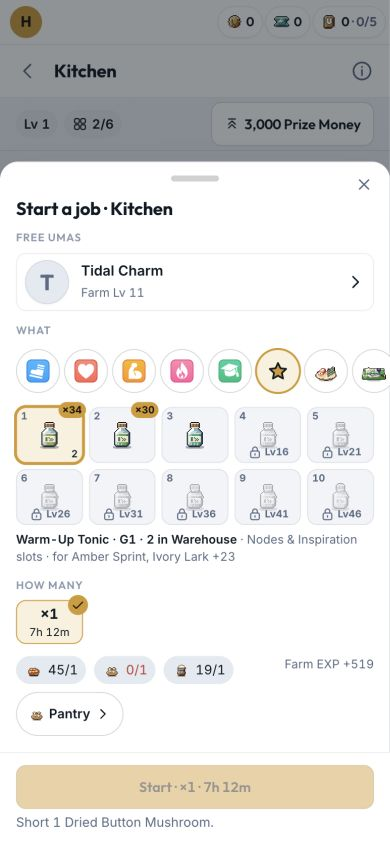
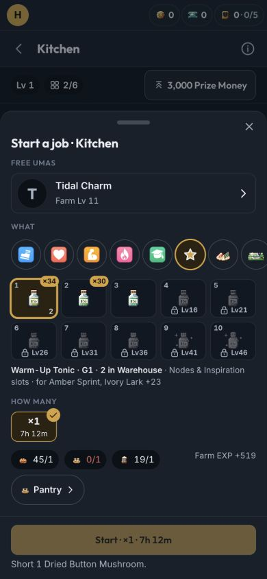

# A04 — Racer tonic art adoption

uma-art 2.10.0 already published the ten original tonic drawings (platform P62, `7ed5bce`). Racer now pins that
release in web and the domain's test-only art dependency (D378). ItemIcon's existing id fallback resolves all ten;
catalogue records, recipes, saves and game rules do not change. The upstream packet was retired before adoption.

## Verification

- `pnpm docs:update`, `pnpm lint`, `pnpm test:ci` and `pnpm build` pass. The initial parallel `pnpm test` hit the
  existing race-engine speed assertion under concurrent load; its unchanged test passes in the full serial run.
- Domain 962, race 61, API 58, web 532 and overlays 2 tests pass. All ten tonic frames have their existing names,
  grades and distinct 32 px cells; renderer tests cover 16/24/32/64 pt and accessible/decorative variants.
- Startup **156.34 KB gzip / 180 KB** locally; the item atlases remain lazy, and the service worker precaches them.
- The real Warehouse tonic shelf, stock sheet and Kitchen recipe sheet show the new sprites at 390×844 in light and
  dark on `busy`, an invented seed. All ten grades are visible in the recipe picker (locked grades dim as before).
  No original-game data, owner save or private art is required. Physical iPhone edges remain the owner's check.

## Production

[PR #127](https://github.com/luismlorenzana/uma-racer/pull/127) merged as `be16a6d2a53ace5dc08082c97856c3a2936bca89`.
The standard [production workflow](https://github.com/luismlorenzana/uma-racer/actions/runs/39633395549) passed both
jobs; its deployed startup is **156.78 KB gzip / 180 KB**. Ready revision `racer-api-00202-fdz` has the immutable image
digest of that exact SHA. Health 200, unauthenticated save/master/overlay 401, Hosting shell 200/no-cache. Live entry
`index-C8ImYzpb.js` contains the expected build, and the service-worker-listed ItemIcon chunk includes all ten new
frames. No owner save or original-game images were downloaded or changed for these checks.
