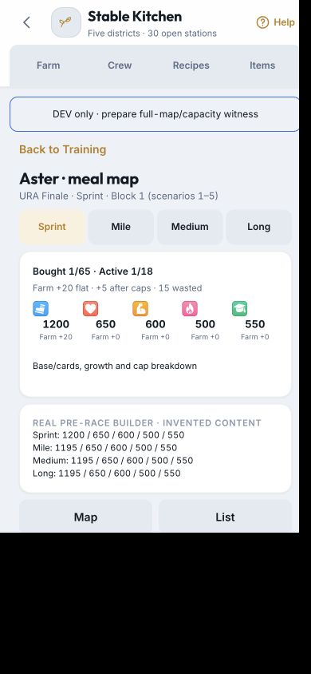

# T124 isolated phone release proof

Captured 2026-10-10 at 390×844 and 375×667. These are invented accounts in isolated
`farm-kitchen-proof-*` databases, no private Uma art, content packs, account boot, owner rows or network writes.
`/dev/farm-kitchen-proof` uses the production host/resolver with explicitly preseeded milestone/stock fixtures;
these screenshots are not evidence those fixture meals were earned. The integration tests separately earn
meals from zero new stock. `/dev/farm-kitchen-proof/release` uses a six-outfit legacy fixture, separate persistent
synthetic server, real archive/cutover protocol and deliberately loses the first acknowledged preparation reply.
Its saved request resumes after reload to the same generation; no owner reset was performed.

## Captures

For each suffix `390` / `375`: `reset`, `recovery`, `active-reset`; all five `garden`, `orchard`, `barn`,
`workshop`, `kitchen`; `cookbook`, `shopping`, `energy`, `receipt`, `extra-map`, `extra-list`, `extra-selected`,
`race-delta`. Additional `export-390` / `export-375` show explicit download requests without restore, and
`energy-after-375` shows the selected deadline after the spend. Exported JSON is private even for the witness
and is not committed.

## Observed interactions and dimensions

- All six district actions are44 px.390×844 field main client/scroll735/735, last tile840;
  375×667558/558, last tile663. A status message previously overflowed the grid; release flex layout fixes it.
  After real Claim at390×844, main still735/735 and last tile840. After Energy at375×667, the status message
  and six44 px controls still fit:558/558, last tile663. A second Energy spend moves2h30m→2h.
- Initial legacy entry shows the narrow reset whitelist/archive requirement rather than missing crew/fake zeros.
  Lost preparation reply shows unchanged Retry/Export; reload resumes to30 stations and retained archive notice.
- Cookbook pins a Swift Bowl goal; the shopping view deducts two owned meals and allocates shared canonical
  ingredients once, with pending production labelled separately.
- Orchard Energy confirmation focuses its44 px action, shows3h→2h30m and12 Energy; real spend yields2h30m,
  canonical11, no output/EXP. Garden's genuine claim produces Carrot×6/+12 EXP and preserves assignment.
- Speed Seed purchase spends one canonical Swift Bowl and activates Sprint only. Reload retains Bought1/65,
  Active1/18; flat20→marginal5/waste15 because Speed1195 caps1200. Real pre-race builder reports Sprint1200,
  while Mile/Medium/Long remain1195 (all other stats650/600/500/550). Map and list give the same named controls.
- Modal focus/Close, explicit Back and contextual links were exercised. These DOM checks are not physical
  iPhone VoiceOver, reduced-motion system settings, background/PWA, Dynamic Type or tactile acceptance.

