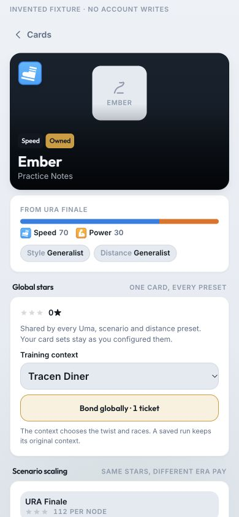
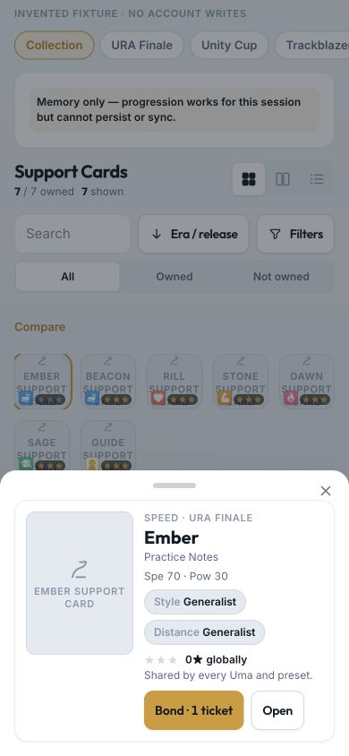
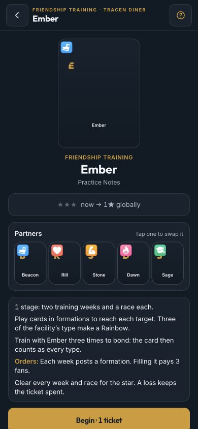
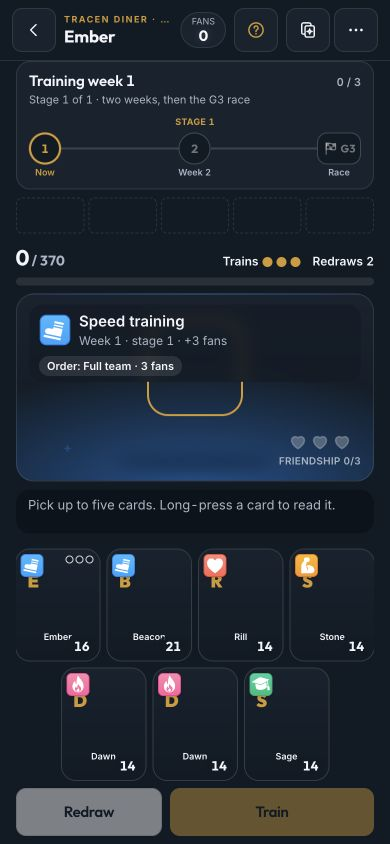
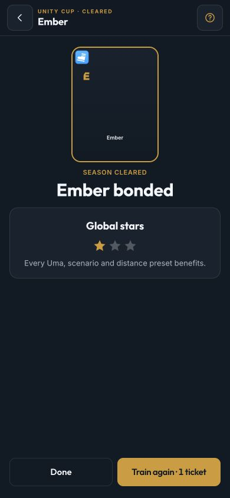
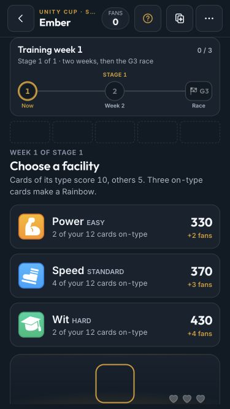

# Global card stars — migration and phone proof

T104 / D255, verified 2026-10-03 against main `4e3d9ee` (D252–D254's four distance presets).
The resulting rules live in [Support Cards](../design/support-cards.md#global-star-cutover-d255).

## Verification

- `pnpm install --frozen-lockfile`: passed; no dependency or lockfile changes.
- `pnpm lint`: passed, all six packages.
- `pnpm test`: passed, **1,057 tests**: domain 469, web 395, API 63, race 61, data 41, assets 28.
- `pnpm build`: passed. Startup **152.13 KB gzip**, below 180 KB; lazy Spark **18.09 KB gzip** and
  Friendship Training **17.97 KB gzip**.
- `pnpm sim:spark`: passed with synthetic rivals, 900 seeded runs, 77% clears, median Drive at clear 60,
  TL1→10 paid runs median 6 / p90 8. Private Claude-owned rival rows were not read.
- `pnpm sim:training -- --content=<existing ignored content/data>`: passed; the worktree has no private packs, so the
  unchanged sim used the primary checkout's ignored card/skill/race packs read-only. First/second/third-star clears
  were 93% / 78% / 74% against targets 90% / 80% / 70%; scenario twists at second star were 77–84%.
- `pnpm sim:constellation`: **existing failure**, one hard tier-1 stamina check: one Stamina card runs 1,400 m.
  An isolated archive of main `4e3d9ee` reproduces it; every one of the fourteen stamina-ladder output rows matches
  the feature branch exactly. No race or node-value coefficients were changed to address this separate balance issue.

Synthetic regression coverage includes all historical card scales, maximum rather than sum, invalid/future schemas,
coupon-flag retention, monotonic cloud conflicts, v24→v25 Dexie migration and initial cloud adoption. Four distinct
preset assignments across fourteen scenarios keep their owned card ids and gain from the same global stars; era decay
and Race Bonus remain scenario-specific. Paid runs retain their frozen setup, seed and journal, recover across context
links, resume oldest first when several legacy contexts exist, and can finish idempotently after global max without
another star/coupon. Screen tests also pin Collection's return link and global reward copy.

## Phone preview

Actual Card page, Cards album and Friendship Training screens were opened at **390×844** in an isolated localhost
preview, using the checked-in invented fixture `apps/web/src/game/__fixtures__/global-cards.ts` and an in-memory
minigame host/journal. No account save, private art or API was used. The temporary preview entry point was removed.

- Changed the Card page's context selector and checked its single global Bond link.
- Opened Collection's card detail; stars and Bond are available there, and the return link stays in Collection.
- Started the real screen, closed its guide, chose a facility and played a hand. Checked frozen scenario/twist copy.
- Replayed an invented clear and checked the global-star reward and its every-Uma/scenario/preset explanation.
- Checked the live board at **375×667** as well: the page stays within the viewport without page scroll.
  New context/Bond controls use 44 px minimum targets; no shared touch or animation rules were changed.

The screenshots intentionally show invented names and fallback art, not imported original-game assets.

### Card page and Collection

### Friendship Training

## Owner check after deployment

Restart/update the installed app, open a card already trained in any scenario and confirm its highest earned stars
now appear globally. Compare that card in another eligible scenario and a different distance preset: the stars are
the same, era pay can differ, and each preset's selected team/assignments remain unchanged. A paid run left open
before the update should resume rather than charge another ticket. Physical-iPhone feel and the owner's real save
are not claimed by this synthetic browser proof; migration happens when the updated app opens that save.
