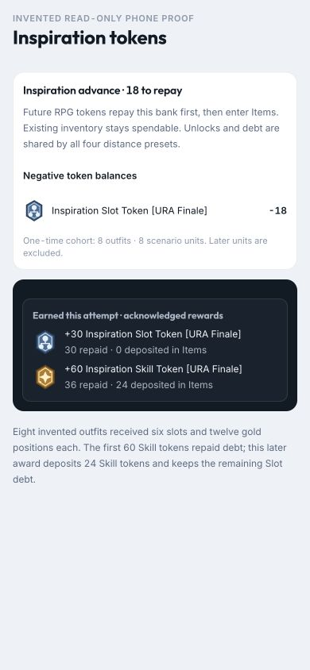
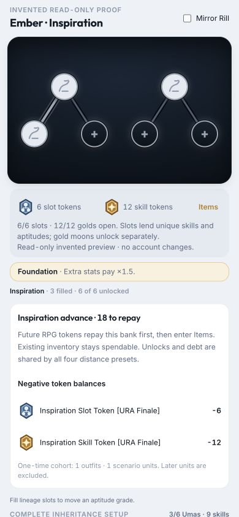

# Inspiration advance — T105 proof

2026-10-04 · D256 · branched from `aa3c79b`. No private roster/content rows, owner save snapshots, extracted art,
credentials, dependencies or infrastructure changes.

## Account behavior

The first updated online sync drains ordinary/RPG queues, then calls the protected advance operation. It freezes the
owned outfits and their existing scenario units once, opens six slots/twelve gold positions and charges matching
negative bank balances, including already-open positions. All four preset builds and existing Item inventory remain
unchanged. No ancestors are selected. Later units are excluded. Interrupted steps resume; the account is not charged twice.

This is deployed application behavior, not a cloud-administrator edit. Without an authenticated owner session here,
the real roster's counts cannot be independently inspected; the owner's next updated online sync applies the pass.
Items shows the frozen outfit/unit counts and outstanding balances. If interrupted, use **Sync and resume advance**.
RPG private content/publication and the Home playable-release gates remain separate (T099); no encounters were invented
for the real account to accelerate repayment.

## Verified with invented rows

- Both local JSON and serial Firestore transaction doubles open/debit once under concurrent calls. Partial Firestore
  completion resumes without charging the first outfit again. Existing positions are included and preset objects are
  unchanged; later outfits/scenarios are excluded. Ordinary writes cannot mutate the bank or close permanent positions.
- Real GameRuntime startup sync installs acknowledged unlocks and publishes them in Zustand. Offline starts do nothing;
  a new local preset edit during the request survives. Failed/lost requests retry, and a late ACK after stopping the
  session changes nothing. Bank parsing is independently checked on API/domain paths.
- Real chapter/battle hosts and grouped command resolver repay exact matching balances. A lost ACK retries the same
  receipt: a gross 60 Skill grant can deposit zero, then another repays 36 and deposits 24. Boss grants repay Slot debt;
  a replay deposits overflow only after zero. Ledger reconstruction reproduces these net quantities.
- Local/Firestore reward repositories read the actual bank even when an older client omits its dependency. Forged
  repayment/metadata, an incomplete advance and stale second-device rewards cannot partially mutate any projection.
- At **390×844**, bank/reward text fits without horizontal overflow. The actual Inspiration presentation shows
  **6/6 slots · 12/12 golds**, preserved chosen ancestors, and separate **−6 Slot / −12 Skill** balances. New controls
  use 44 pt minimum targets and safe-area padding; existing stage motion/planets are unchanged.

## Reproduce

- `/dev/inspiration-advance-proof`: read-only invented bank plus zero-net/overflow reward presentation.
- `/dev/inspiration-proof?advance=1`: actual Inspiration component, fully opened invented unit and bank.
- Both routes are DEV-only, with no account reads/writes of their own and no real rewards. Normal app providers may
  initialize in the background; captured data is entirely synthetic. Physical iPhone/PWA sign-off still belongs to the owner.

Lint, **1,075 tests** and build pass. RPG progression/combat and Spark sims pass. Friendship Training passes with
`pnpm sim:training -- --content=<existing-ignored-pack-dir>` (existing ignored packs, aggregate output only);
the isolated worktree has no imported packs of its own.
Production startup JS is **152.22 KB gzip**, Spark's individual lazy chunk **18.09 KB**, Friendship **17.97 KB**.

