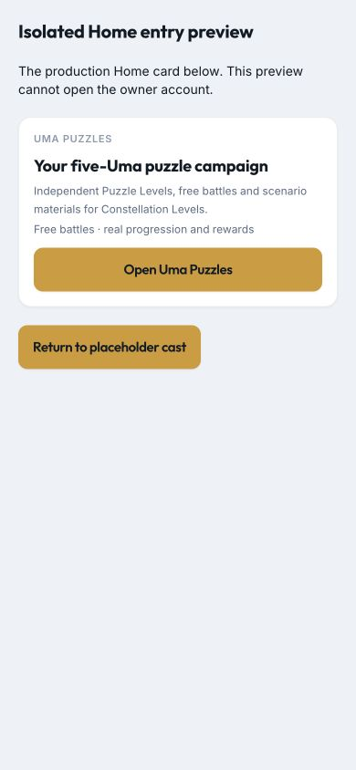
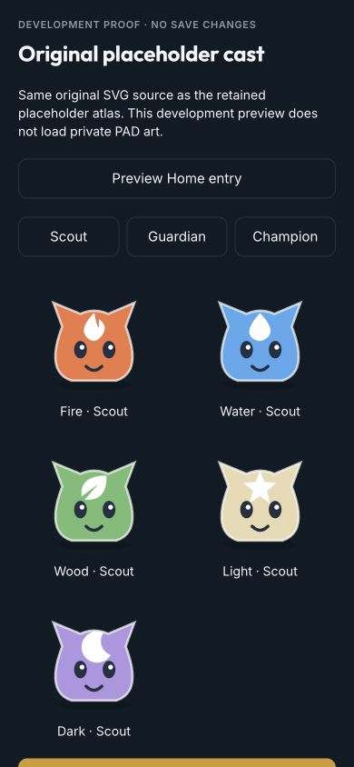

# T109 — owner-export Puzzle art acceptance

2026-10-08, following the owner's local image delivery and explicit authorization to remove backgrounds and import.
This is an aggregate-only record. No original names, source rows, portraits or actual-art screenshots are in git.
The living contract is [private Puzzle content](../technical/puzzle-content.md); D292 closes T109 under D104.

## Inputs and coverage

All 20 supplied static WebP originals remain unchanged. Seventeen built-in image-editor cutouts passed native PNG
decode, actual transparent/visible pixels, bounded dimensions/size, source/output hash evidence and private visual
review. Three service rejections remain excluded; no retry circumvents the filter or substitutes another identity.
These are **AI-edited derivatives**, not pixel-exact transparent original exports. Private evidence records the full
prompt, method, original/output hashes and explicit art revision. No restricted source pages were fetched.

Five starter/evolution families: Fire 4, Water 3, Wood 3, Light 4, Dark 3. Coverage resolves 14 chapters / 392 nodes, including
both Dark champion variants, with zero unresolved references. Role memberships overlap: 8 striker, 8 healer, 5 guard,
5 converter, 5 ward, 5 champion. Stronger available variants fill guardian/champion roles. No imported combat values,
changed encounter recipes, seeds, rewards, debt, save fields or other-mode changes.

## Private publication

Both offline imports and validation pass. Unchanged-input reruns retain identical source, atlas, pack and manifest
hashes, with 17 verified cache hits; original files and immutable outputs are never replaced.

| Object | SHA-256 | Bytes |
|---|---|---|
| Atlas page | `b85bcf3cdcddfee35b69c1749eb5f217912d07a231a0f251235463dffb4032d8` |607,052|
| Atlas descriptor | `d34865c740744bfa5ea57a59efaeb6de480cdad399d43dbc9f8ac4a00a6f7deb` |1,914|
| Active cast pack | `2f24f4a790bb2a0a437537bf4e252234ad00dc8630102a3f7f53a4e9f9cc6463` |8,371|
| Catalog | `25b777cd3597ee8b6a040d052160038dabae4f6d025345055104fe465fbe51a8` |443|

Existing-runbook dry run and publication both pass: `3717d876c9b2` → `0466b6e1ffb1`, 4 uploads / 617,780 bytes,
2,067 unchanged manifest tuples, 2,071 current objects. Only the active catalog tuple changes; its old immutable object
remains physically present. Old placeholder pack/descriptor/page remain in the manifest and the new catalog. Independent
downloads verify all 4 new objects plus all 3 placeholder objects and the old catalog by full hash/length; remote manifest
matches local. The primary ignored content tree retains generated outputs, all 37 original/derivative files and source
evidence so future imports retain this upgrade. No unrelated private roster rows were inspected.

## Checks and preview

- `pnpm lint`: 6 packages pass.
- `pnpm test --concurrency=1`: 1,483 tests pass (domain 700, race 61, API 84, web 558, data 44, assets 36).
- `pnpm build`: pass; startup 154,329 bytes gzip (limit 180,000), Spark 18,159; content preflight 1,159,
  Hub 1,632, map 5,575, battle 4,084 and battle stage 5,150 bytes gzip.
- `pnpm sim:puzzles`: 288 engine fixtures, 640 campaign battles and 86,016 route/economy variants pass unchanged.
- `pnpm sim:spark`, `pnpm sim:training`: pass unchanged.
- Private loopback atlas proof at 390×844 displays real imported WebP frames, transparent backgrounds and all 17
  portraits, with no horizontal overflow. Contact-sheet and Fire/Dark captures stay in ignored acceptance evidence.
  This gallery checks atlas decode/layout, **not** an authenticated gameplay/device run.
- Synthetic isolated Home proof at 390×844 verifies art-neutral copy, no horizontal overflow and 48 px buttons.
  No owner account, gameplay reward or save write was used.

## Application and owner acceptance

The art publication is independently verified above. The accompanying branch only changes Home/DEV proof copy,
its regression test and documentation; the existing authenticated loader/lease/renderer needs no gameplay changes.
Application PR/merge/deployment witness is added to the PR after CI/deployment checks.

After refreshing/reopening the installed app, **newly entered fights** select the active cutout pack. An already-open
fight intentionally retains its old placeholder pack until settlement. Read-only `/puzzles/content` previews the
verified active pack. Do not clear app data to refresh content. Physical-iPhone art readability, actual gameplay and
second-device acceptance remain owner checks in [release acceptance](uma-puzzles-release-acceptance.md).
