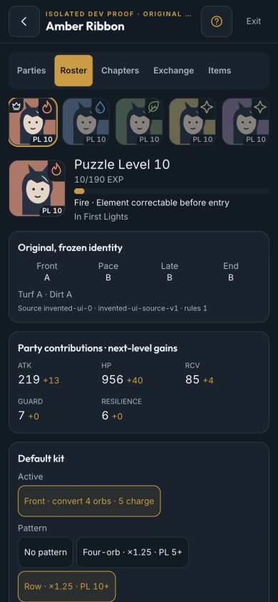

# Puzzle setup parity phone proof — T117 / D293

2026-10-08. These are isolated DEV browser proofs, **not owner-account or physical-iPhone acceptance**.
Every portrait, name, source, enrollment, checkpoint and enemy is invented. No sign-in, account provider, production
API, real save or private art is used. Screens use the genuine persistent Puzzle host and shared production components.

## Reproduce

Run the web dev server and open:

- `/dev/puzzles-ui-proof/setup`: two assigned parties, one free enrolled PL15 candidate and ten total presets.
- `/dev/puzzles-ui-proof`: every enrolled outfit assigned; Add/Swap opens the empty picker.
- `/dev/puzzles-ui-proof/first-use`: no enrollment and ten empty parties; Open Roster is first.

Each namespace uses its own resumable `puzzle-proof-*` Dexie database, separate from the owner save. Reload preserves
edits; a previously edited proof is not automatically reset. Close the initial guide normally. Party/profile/Chapters
links retain their namespace on nested refresh. The routes and fixture modules are absent from production.

## Browser checks

At **390×844** and **375×667**, inspect roster sections/filter chips, editor cards/inline kit choices, populated and
empty picker sheets, profile member strip/EXP, Hub onboarding/party10 and Chapters chips. In Roster, editor, profile,
Chapters, Items and Exchange, DOM measurements found **zero native selects**, document scroll width equal to viewport,
and **zero nonzero-size button/link targets below 44×44**. Horizontal chip rows scroll internally.

Hub has ten Edit party destinations; first-use has ten Fill party destinations. Scroll reaches Party 10 with the
unchanged repayment bank below. Populated picker offers the free candidate only; empty picker has no Move mode and
links to Roster. Swap was committed through the real host, replaced slot 1 with the incoming default kit/leader mark,
and survived refresh. Profile Back returned to the named party; the original proof membership was restored using
Swap, not direct database edits. Regression tests additionally assert stale-sheet rejection, five member-strip links,
PL/name/id ordering, open-fight locks, navigation memory and unchanged material acknowledgement/retry guards.

Screenshots were captured before the Swap interaction, as unmodified JPEG viewport exports:

| View | 390×844 | 375×667 |
|---|---|---|
| Roster | [image](roster-390.jpg) | [image](roster-375.jpg) |
| Party editor | [image](party-editor-390.jpg) | [image](party-editor-375.jpg) |
| Free picker | [image](picker-filled-390.jpg) | [image](picker-filled-375.jpg) |
| Empty picker | [image](picker-empty-390.jpg) | [image](picker-empty-375.jpg) |
| Party profile | [image](profile-party-390.jpg) | [image](profile-party-375.jpg) |
| First-use Hub | [image](hub-first-use-390.jpg) | [image](hub-first-use-375.jpg) |
| Hub scrolled to Party10/bank | [image](hub-party-10-390.jpg) | [image](hub-party-10-375.jpg) |
| Chapters | [image](chapters-390.jpg) | [image](chapters-375.jpg) |

## Transport and acceptance

Domain/API tests use **ten full parties, fifty synthetic outfits and all 140 checkpoint rows**. Correction or default-kit
edit plus a full-party save reads **53** distinct records; two-party transfer reads **42**, below the unchanged200
ceiling. The resolver derives membership from all ten presets and requires every holder checkpoint to be declared
before checking locks. Omitted locks and membership moved while offline reject. Existing all-five lock sets/receipts
still retry. Party10 parses in presets/checkpoints/battle identities; 0/11 reject in domain and standalone API mirror.
Real IndexedDB tests retain five-party saves without writes, round-trip party 10 and reserve/sync its same frozen fight.

Lint, all **1,500 tests**, build, `sim:puzzles`, `sim:spark` and `sim:training` pass. A first concurrent local test run
hit the unchanged race 250 ms timing assertion under CPU contention; `pnpm test --concurrency=1` and the final
`pnpm lint && pnpm test && pnpm build` pass without weakening any threshold. The startup script is **154,349 bytes
gzip (154.35 KB)**, retained lazy Spark **18,151 bytes (18.15 KB)**; exact build
measurements are in the PR. Puzzle routes, Pixi and Firebase remain lazy. Existing deployment runs API readiness before
building/deploying the web, so party 6–10 writers ship after the matching API.

Still pending: owner iPhone/PWA playability, tactile comfort, VoiceOver and real-account/second-device acceptance under
the [release protocol](../uma-puzzles-release-acceptance.md#owner-productioniphone-protocol). Browser evidence does not
close those checks. No combat/reward/material rules, CL spends, preservation/backup, release flags, RPG code,
dependencies or infrastructure changed. Items/Exchange changes replace choice controls only; Farm's existing shared
material presentation is unchanged.

