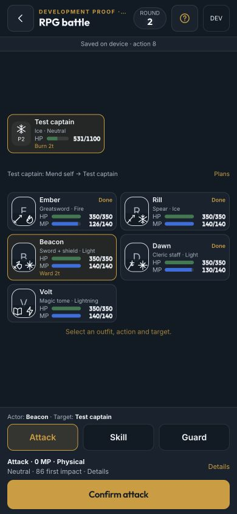
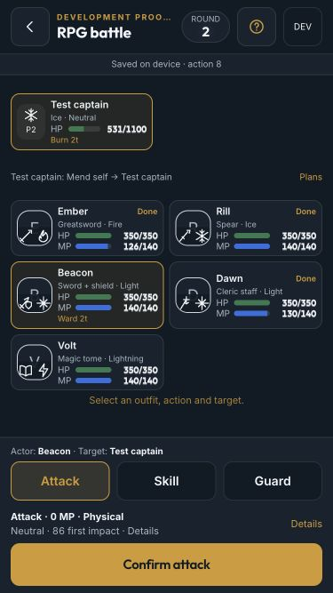
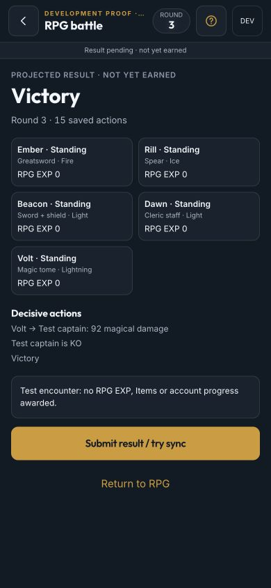
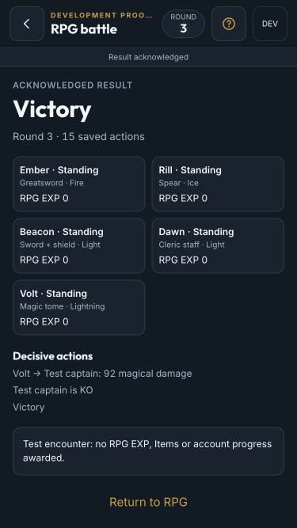

# RPG battle phone proof — T094

2026-10-02. This is the battle-screen handoff, not campaign release (T095–T099).

## Rehearsal

Run the normal local API and web development servers, then open
`/dev/rpg-battle-proof?mode=boss`. `practice`, `boss` and `loss` keep separate, device-local journals in
`uma-rpg-battle-proof-v1`. DEV opens proof-only reset/mode tools. Refresh resumes the saved action index and hash;
changing display size, skipping cues or changing art never rerolls. No account save or reward command is used.
The route and invented fixtures do not exist in a production build. A production battle route requires an actual
frozen checkpoint; there is still no Home/chapter launch button.

The proof cast is invented: Ember (Greatsword/Fire), Rill (Spear/Ice), Beacon (Sword + shield/Light),
Dawn (Cleric staff/Light), Volt (Tome/Lightning). Runtime Uma portraits were checked locally as presentation only.
All committed screenshots use `art=off` and contain **no extracted data or original-game images**.

## Verified

- Browser at 390×844 and 375×667: five readable party cards, weapon/element overlays and thumb actions;
  measured all visible links/buttons ≥44×44, document dimensions equal viewport, no document scroll.
- Physical Fire rider against Ice: preview Weakness, MP cost and exact reducer effects before confirmation.
  Cue playback locks input; journal already holds the action. Refresh restores that action, not a new fight.
- Beacon guards the announced Volt target; the enemy hit is intercepted. Dawn's Light Focused restores the wounded
  guard's 65 HP and applies Ward. The captain's second phase reveals a new intent.
- Victory includes enemy KO, saved-action count and decisive cues. Pending says **not yet earned**; acceptance
  reads the receipt and the synthetic proof explicitly reports no EXP/Items/account progress.
- Loss returns all five KOs; only acceptance enables free retry, retaining the frozen seed and kit. Automated
  tests compare exact inputs/hashes, not just similarly drawn screens.
- Paged guide, keyboard focus containment/Escape, reduced motion, pointer cancel, background/orientation skip,
  explicit missing content/journal/takeover/conflict and stale action counts are covered by browser/unit checks.

Physical iPhone safe-area, VoiceOver and 120 Hz feel still require the owner's T099 device pass; desktop viewport
checks are not that sign-off. Real PriConne portraits, chapter pacing and rewards belong to later tasks.

## Captures

