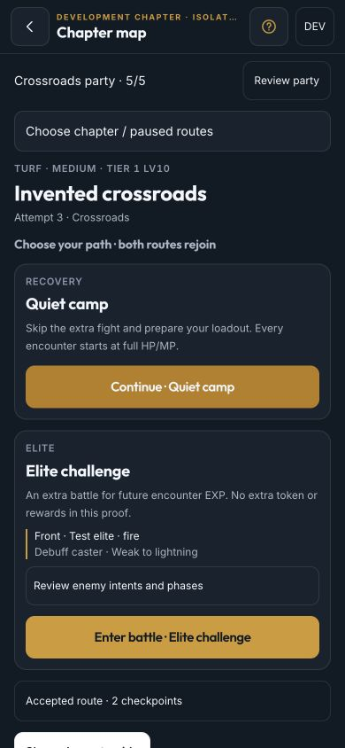
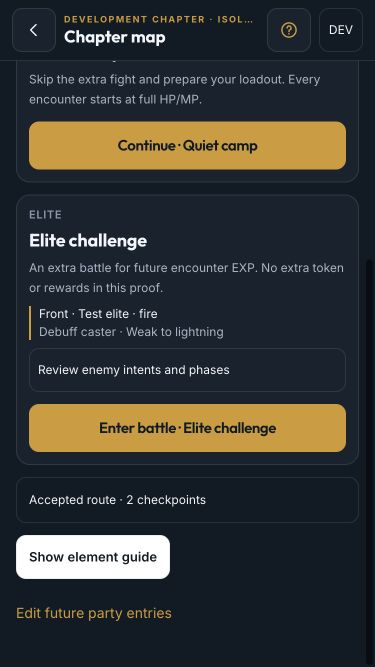
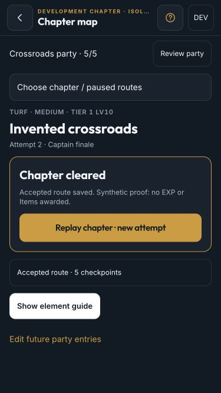

# RPG chapter phone proof — T095

2026-10-02–03. This verifies chapter navigation, not the M028 playable release. Real private PriConne content,
RPG EXP/trees/promotions, Inspiration rewards and the Home entry still belong to T096–T099.

## Rehearsal

Start the web development server and open `/dev/rpg-chapter-proof`. No API server is needed for this isolated
rehearsal. It uses the real chapter/battle hosts and grouped client sync against a simulated account, with separate
device-local Dexie databases `uma-rpg-chapter-proof-v1` and `uma-rpg-chapter-proof-v1-account`. Nothing writes
to the player's account database, Racing, Training, Farm, Items or EXP. The proof route/fixtures are absent from
production bundles. All committed screenshots contain invented data and no extracted images.

DEV controls hold acknowledgement, acknowledge queued commands, simulate a stale remote revision and reset only
these proof databases. They are never production recovery controls. Automated host tests use the actual API command
parser/resolver; API repository tests check the receipt boundary in both local and Firestore transactions.

## Verified

- At 390×844 and 375×667: readable branching path cards, enemy roles/weaknesses, phase/intent preview, five-outfit
  party review, pinned header, internally scrolling map and safe-area classes. All visible buttons, links and
  summaries measure at least 44×44; document dimensions equal the viewport without horizontal overflow.
- Opening → crossroads → camp → approach → phased boss clears in two encounters. Replaying explicitly increments
  attempt identity. The alternative elite route adds a third encounter and rejoins at the same approach/boss.
  The fixture is intentionally short; its two/three fight counts and Tier 1 Lv10 recommendation are the
  [reward fixture handoff](../technical/rpg-chapter-content.md#synthetic-reward-fixture-and-private-authoring-handoff), not production pacing.
- A locally completed boss remains Pending while acknowledgement is held. Refresh preserves that pending result;
  no next node or Cleared state appears. Only acknowledged winning evidence enables the explicit map transition.
- Leaving a fight resumes its saved turn. Switching to a second chapter requires an explicit pause; accepted earlier
  nodes remain, and retry retains the exact frozen kit/party/seed with the next retry ordinal. Automated tests also
  prove subsequent party edits affect future encounters only, including equipped-skill restore after dictionary decoding.
- The separate deliberate defeat probe genuinely KOs all five outfits (15 Attack actions / five rounds in the
  browser), accepts zero EXP and no map movement, and offers a free identical-encounter retry. A recommendation of
  Tier 1 Lv50 warns the Lv10 party without blocking entry. Reload preserves its retried battle.
- Simulating a newer account checkpoint rejects a stale pause/result rather than applying it. Explicit recovery
  fetches accepted account state, archives the rejected terminal journal locally and offers an explicit restart of
  the same frozen fight. It never resends the rejected result, changes its seed or grants rewards.
- Missing/drifted packs do not fall back to test teams. Graph tests reject invalid references, duplicate ids,
  missing actor/art/action fields, cycles, unreachable/dead-end nodes and scenario/version drift.
- The paged chapter guide and recovery confirmation contain keyboard focus, make background controls inert,
  restore focus on close and support Escape. Reduced-motion battle playback is reused unchanged from T094.

Physical iPhone Home Screen safe-area/gesture behavior, VoiceOver, background/network behavior across actual devices
and 120 Hz feel remain the owner's T099 sign-off. Desktop viewport testing does not substitute for that pass.

## Verification and captures

`pnpm lint`, `pnpm test` (957 tests), `pnpm build`, `pnpm sim:rpg:combat` and `pnpm sim:rpg:progression` pass.
No combat/progression coefficients changed. Startup entry gzip is **151.87 KB** (limit 180 KB); lazy chapter map
**10.03 KB**, battle screen **9.70 KB**, shared battle host **9.36 KB**. These are Vite's individual gzip chunks,
not a combined route-download total. Production excludes the invented campaign, loss probe and DEV tools.

