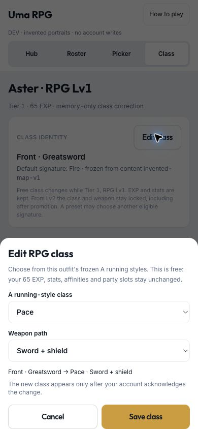
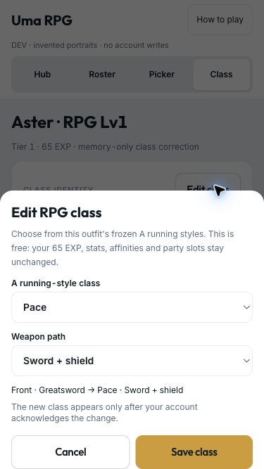

# RPG level-one class correction — D259

2026-10-05. `/dev/rpg-release-proof` has a memory-only Class view using the real `RpgClassEditor` with an invented
Tier 1 Lv1 profile and 65 partial EXP. It opens no account tables and sends no commands; DEV code stays out of production.

## Browser checks

- At **390 × 844** and **375 × 667**, the bottom dialog fits without horizontal overflow. Both selects are 44 CSS px
  tall; Cancel and Save class are 48 CSS px. All controls remain inside the viewport.
- Choosing Pace replaces the weapon choices with Spear / Sword + shield. The preview names old and new class/weapon.
  Save is disabled for an unchanged selection. Saving the invented choice closes the dialog, retains 65 EXP and
  updates its class label. Keyboard trapping and focus restoration are covered by component tests.
- Domain tests cover source-A eligibility, matching weapons, repeatable fresh corrections, partial EXP/stat preservation,
  Lv2 exclusion and promoted Tier 2 Lv1 exclusion. UI tests check restricted options and no optimistic class update.
- Dexie + grouped API tests cover pending edits, stale profile/checkpoint revisions, open frozen battles (including
  members removed from the current party), lost acknowledgements and exact duplicate retries. Both local JSON and
  Firestore repositories reject progressed profiles, hidden EXP/stat/signature edits and omitted dependencies.

## Screenshots

These are invented profiles without original-game art, not production-account edits.

## Verification

`pnpm lint`, `pnpm test` (1,120 tests), `pnpm build`, `pnpm sim:rpg:progression` and `pnpm sim:rpg:combat` pass.
Startup JS is **152.32 KB gzip** (limit 180 KB); lazy RPG setup **48.46 KB / 14.93 KB gzip**;
Spark **58.74 KB / 18.10 KB gzip**. No save schema, dependency, content or infrastructure change.
No task spec was assigned to this small owner request. Real-account class changes and physical-iPhone input remain
owner validation; this proof does not claim either.
