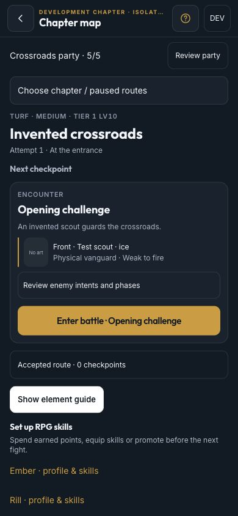
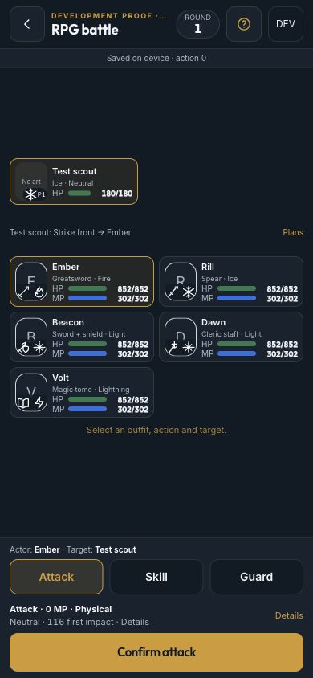
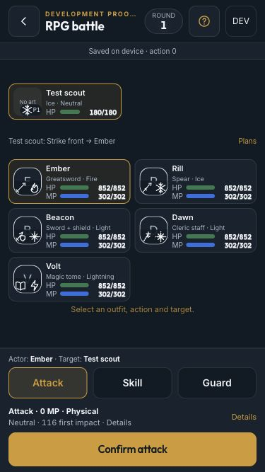

# T097 content presentation — phone proof

2026-10-03, desktop browser preview, **not physical-iPhone sign-off**. The isolated
`/dev/rpg-chapter-proof` uses invented profiles/opponents and separate proof stores. No private character art
or rows appear in these checked-in images. Real portraits were separately imported/native-decoded privately;
authenticated published-content/device verification remains owner/Claude and T099.

## Checks

- Chapter preview now reserves a labelled portrait tile beside opponent role, element and weakness; the fallback
  explicitly says **No art**, never another character. Expandable intents/phases and entry controls remain readable.
- Five-party battle portraits preserve element/phase overlays and HP gauges. At **390×844** and **375×667**,
  document width/height equals viewport; no horizontal or vertical page overflow during battle. Every enabled
  button measured at least 44 CSS pixels high; footer controls remain in the thumb zone.
- Confirmed an Attack: action count became 1 before cue playback. Reload retained action 1, enemy HP 64/180 and
  the acted member; returning to map offered **Continue frozen battle**, not another encounter.
- Fixture tests cover hash-specific old/new portrait joins, lazy loading, held Blob release, unavailable art,
  exact retained pack resume, missing-old-pack blocking, MIME/hash failures and retry after a fetch failure.

## Captures

## Build and release boundary

Startup entry **151.94 KB gzip** (limit 180 KB, after rebasing the latest lineage UI). Lazy RPG setup **12.24 KB**, map **7.77 KB**, battle **10.74 KB**
and shared enemy/content chunk **13.55 KB** gzip; Spark Match screen **18.07 KB** gzip. Private data/images are
not bundled. Full lint/test/build and both existing RPG sims pass; the existing 250ms race timing assertion
failed once under concurrent workspace load (350ms), then passed with suites serialized, without a test change.
The [private URA handoff](rpg-private-ura-handoff.md) records aggregate draft checks and required publication.
Tokens and Home release are still T098/T099, not this screen change.
