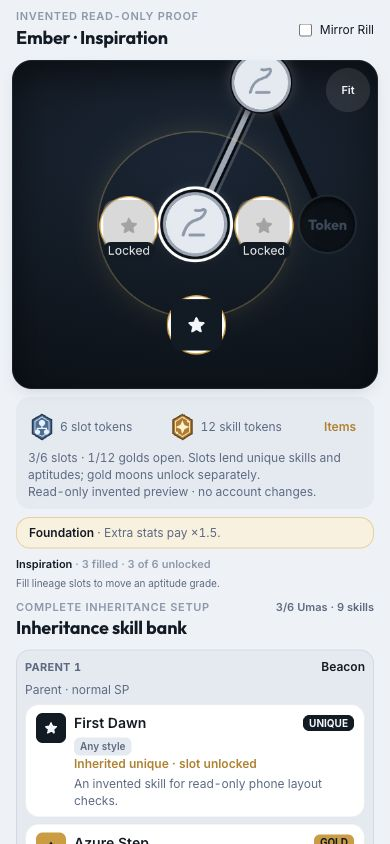
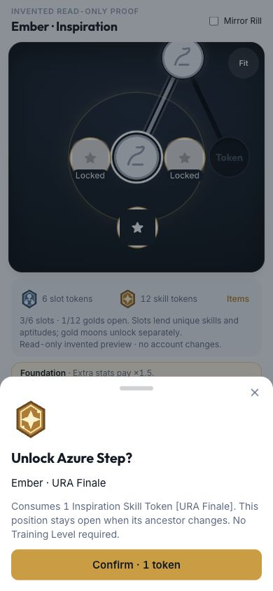
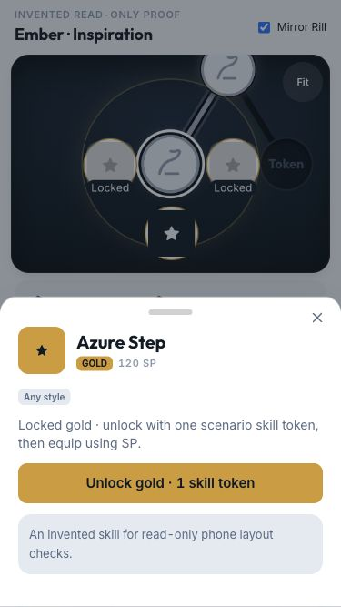
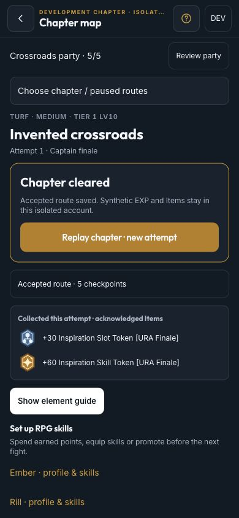

# RPG Inspiration reward and unlock proof — T098

2026-10-03. Implements D250, rebased onto `60f584c` so D249's compact two-row Inspiration and complete six-slot
skill bank remain intact. This is not the T099 Home/playable-content release.

## Rehearsal and privacy

`/dev/rpg-chapter-proof` uses the real chapter/battle hosts against isolated client/simulated-account Dexie databases.
Winning battles award synthetic RPG EXP; winning map transitions collect synthetic global Item tokens in those
databases only. `/dev/inspiration-proof?node=parent0-gp0` renders invented outfits/skills and a read-only token stock.
Its Mirror Rill checkbox compares single-side and exact-opposite-side grandparent prices. Its confirmation cannot
spend anything. Reward/unlock commands in these proofs never address the player's account database; the normal
app providers can still initialize in the background. Both routes/fixtures are excluded from production. All
captures below contain invented data and no original-game art.

## Verified behavior

- At 390×844 and 375×667, the map/result and Inspiration sheets fit the viewport without horizontal page overflow.
  Visible action targets are at least 44×44, with internally scrolling skill banks/results and safe-area classes.
  Semantic moons retain Unique above a parent/below a grandparent and golds left/right. Edge orbits do not collapse
  onto their portrait. Fit is 44 pt and joined-content rerenders do not undo a user's pan/Fit choice.
- The invented opening fight wins in two saved attacks. Held acknowledgement and a reload preserve its journal,
  result and frozen +60 Skill Token preview; nothing is collected. Explicit result submission earns EXP, but Items
  remain uncollected until **Accept win & collect** moves the accepted map checkpoint. The map then names the
  collected scenario Skill Tokens.
- The shortest route reaches the phased boss and wins in six saved attacks. Accepted boss EXP is separate from
  the explicit clear transition. Clear collects +30 Slot Tokens; accepted attempt totals show 30 slots/60 skills.
  Reload preserves those totals. Optional-route and replay identities are covered by automated host/server tests.
- Inspiration retains the full six-slot bank, explicit slot/gold statuses and scenario stocks. A single-side invented
  gold shows 240 SP; the exact mirrored grandparent shows 120 SP. The gold confirmation names the Uma, scenario,
  token family, one-token cost and permanent position. Keyboard Tab remains inside the new detail/confirmation
  dialogs; Escape closes them, restores focus and removes background inertness.
- Automated pure/local/Firestore tests cover six slot/twelve gold spends, wrong scenario/closed parent/missing gold,
  independently retained positions, exact mirrors/character exclusions, shared full-chain SP/race-budget agreement,
  cheaper own/card/parent sources, offline reservations, lost ACK/duplicate receipts, stale Uma/Item/checkpoint,
  ordinary-write isolation and explicit recovery. Typed grant/spend evidence repairs token stacks even with
  cross-device clock skew and never permits a negative final quantity.
- Save v14/Dexie v23 and old cloud adoption grandfather TL9's first side, TL10's both sides and filled-under-gate
  branches, including their gold positions. EXP, assignments, Extra stats and entity versions remain unchanged;
  no token grant/charge is invented. Repeated migration is stable; a fresh explicit TL10-closed row stays closed.
  Frozen kit v1/v2 replays remain identical and unrewarded for tokens; v3 adds frozen token metadata without
  changing input, EXP or replay hashes.

After the rebase and a clean reload, desktop browser verification shows no application errors; transient Vite
hot-reload errors occurred while files were being rebased, and the preexisting DEV hydration-fallback warning remains.
Physical iPhone Home Screen safe areas, VoiceOver, actual device/network recovery and real published content remain
the owner's T099 checks. The private URA draft/publication handoff is unchanged and no infrastructure was edited.

## Commands and known baseline issue

`pnpm lint`, `pnpm test` (**1,036 tests**), `pnpm build`, `pnpm sim:rpg:progression` and `pnpm sim:rpg:combat` pass.
The progression sim traverses both routes across five scenarios/two tiers with unchanged EXP pacing: each completed
scenario funds five six-slot/twelve-gold builds, at least 30/60 tokens, and optional fights add surplus.

`pnpm sim:constellation` completes its tables but reports the **preexisting tier-1 stamina ladder failure**:
one Stamina card can run 1,400 m. Unchanged main `700c247` reproduces the exact ladder
`345 / 498 / 738 / 869 / 1093 / 1200` and the same failure with `--ladder-only --tiers=1`; current main `60f584c`
changed presentation only. No race coefficients were retuned to hide that unrelated issue.

Production startup entry: **152.06 KB gzip** (≤180 KB). Individual lazy chunks: Spark **18.08 KB**, chapter map
**5.81 KB**, battle screen **10.97 KB**, Inspiration/Constellation **12.04 KB**. These are individual Vite chunks,
not combined route-download sizes. No dependencies, original rows/art or private generated packs were committed.
T098's rewritten spec is retained in its initial docs commit and removed from the finished PR under D104.

