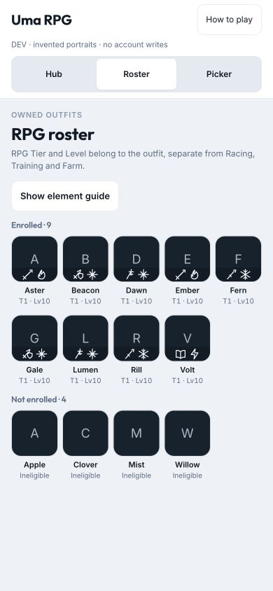
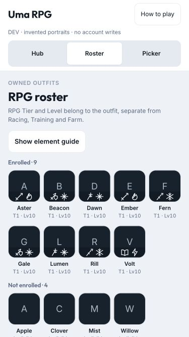
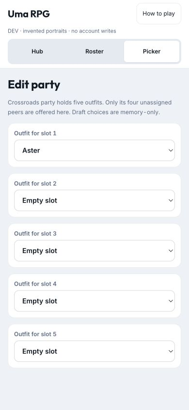
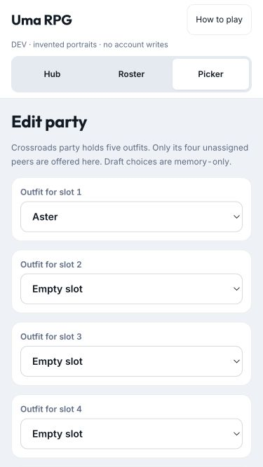

# RPG roster and party picker proof — D258

2026-10-04. `/dev/rpg-release-proof` now includes read-only Roster and memory-only Picker views beside the existing
Hub proof. All outfits/names are invented; no account tables, transport, enrollment or rewards are accessed.
The DEV route and fixtures remain absent from production. The Hub's production presentation is unchanged.

## Browser checks

- **390 × 844:** five roster tiles per row, enrolled group before unenrolled, no horizontal overflow;
  tiles measure about 67 × 101 CSS px. Weapon/element overlays are glyph-only with full accessible names.
- **375 × 667:** five tiles per row remain about 64 × 98 CSS px; no horizontal overflow. Menu content scrolls
  inside the shell when needed, and each native outfit dropdown is 44 CSS px tall.
- All five saved Crossroads members are excluded from the empty second party's dropdowns; four unassigned
  enrolled outfits are offered. Choosing Aster in slot 1 retains that selected value and removes her from slots 2–5.
  No unregistered outfit becomes selectable. The browser reported no error-level console messages in this proof.
- Helper/component tests also cover pending additions, acknowledgement before transferring saved members,
  removed-current-draft members moving slots, legacy shared selections, lost ownership, malformed commands,
  stable sort ties, accessible compact identities and icon art without large-bust requests.

## Screenshots

Only invented names/initial portraits are checked in; real Uma art stays private.

## Verification

`pnpm lint`, `pnpm test` (1,102 total; 433 web), `pnpm build`, `pnpm sim:rpg:progression` and
`pnpm sim:rpg:combat` pass. Startup index JS is **152.31 KB gzip**, below 180 KB; lazy RPG setup is
**44.93 KB / 14.14 KB gzip** and Spark is **58.74 KB / 18.10 KB gzip**. No dependencies, save fields,
balance constants, private rows or production infrastructure changed. No task spec was assigned to this owner note.
Real-account changes and physical-iPhone gameplay acceptance are not exercised by this synthetic proof;
the standing [RPG release acceptance](rpg-release-acceptance.md) remains open.
