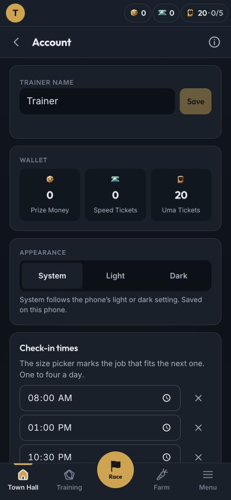

# T144 — completed cutover follow-up

The owner explicitly approved this follow-up on 2026-10-21 alongside A04 and SE1. It **removes** the temporary
migration capability; it does not execute a purge, reset a save or claim the owner's physical-phone acceptance.
D362 was reserved for this record and is appended without rewriting earlier decisions.

## What remains, what leaves

- Removed: the one-release API route, repository deletion code, client purge request/response types and parsers,
  boot/sign-in/reconnect calls, option/key exports and the obsolete test scaffolding.
- Retained: save generation/protocol 2, Dexie schema 1 and its existing rows/outbox, normal local-first boot and sync,
  Firestore audit marker, any historical local-file marker and device preferences/caches. No schema bump or migration.
- M034 and T144 specs leave in the same PR (D104). Their final versions remain at
  `9370e0a:docs/tasks/{M034-generation-2-cutover,T144-the-release}.md`.
- Original cutover: `ec5b1bd`, API `racer-api-00188`, content `9ba4cdd37cca`, 2026-10-15. Its recorded purge was
  30 collections/3,676 documents. SE1's independent 2,076 retired-object cleanup is recorded in
  [its acceptance note](../se1-master-data/README.md), not rerun by this task.

## Verification

- API route metadata exposes only health, save, sync, master and content. The retired endpoint returns 404 with auth
  on and off, before any handler or save access. Existing 401/426 and protocol/body validation tests stay in place.
- Boot/reconnect/sign-in/reload tests allow only save/sync requests, with and without historical device markers.
  The account and marker remain unchanged. Local persistence retains the audit field and never parses or alters the
  retired dev save; Firestore sync/pulls neither read nor change the audit document.
- Existing save/sync, offline, conflict, idempotency and two-device tests pass. No owner save or original-game rows
  are used; every new fixture is synthetic.
- Local API 8095 and browser 5190, disposable proof save: a fresh device boots to Account with 20 Uma Tickets and
  clear Sync, and reloads to the same account. Phone-width check at 390×844; local retired-route probe is 404. No
  Simulator, real-account mutation or private content download.

`pnpm docs:update`, `pnpm lint`, `pnpm test:ci` and `pnpm build` pass on the rebased worktree: domain 961, race 61,
API 53, web 530 and overlays 8 tests. Startup **156.33 KB gzip / 180 KB** locally. No infrastructure, game constants,
save schema, current account or original-game content changed. Owner iPhone/PWA checks remain pending.

## Protected merge and production

[PR #129](https://github.com/luismlorenzana/uma-racer/pull/129) passed required CI and merged as
`bdeb4fca3d3d5082e3cc6459be849af34394eb0a`. Both jobs of its standard
[production workflow](https://github.com/luismlorenzana/uma-racer/actions/runs/39705734143) passed. Deployed startup:
**156.80 KB gzip / 180 KB**, one static startup chunk.

Independent post-deploy checks, 2026-10-21 (local date):

- Latest created and latest ready revision both `racer-api-00204-qvd`; the ready image matches the artifact tagged
  to that exact merge SHA, digest `sha256:12d1a42ad7a94adf92825d7044c7bb2f5abc4f3ea612551d4aa9a044abc39472`.
- API health 200; unauthenticated save/master channel/overlay each 401; retired migration endpoint **404**.
- Hosting shell 200/no-cache, `/assets/index-B6ILVhMp.js` contains build `bdeb4fca3d3d`, and the live service worker
  precaches that entry. Its ItemIcon chunk still includes all ten published tonic frames.
- No owner session, save access, purge, reset or private image download was used for verification. Physical
  iPhone/PWA feel and sign-in checks remain with the owner (P60); local proof is recorded above.

A04 and SE1 are also Done in the central program queue through
[uma-platform PR #44](https://github.com/luismlorenzana/uma-platform/pull/44), merge `bc363e1`, with both PR and main
CI green. Shared push stays parked. This status-only closeout publishes no package and changes no infrastructure.
