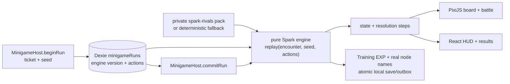

# Milestone 22 — Spark Rival Circuit

**Outcome:** the adjacent-swap Spark Match is replaced by a phone-first, three-wave continuous-drag puzzle battle. A run
has real rival Umas, strategy advantage, visible enemy intent, Drive/Resolve pressure and a clear/loss arc; it remains the
only way to earn Training EXP and open constellation nodes.

Decisions: D169–D172. Source of truth: [Minigames](../design/minigames.md#spark-match--rival-circuit). Research:
[Spark Rival Circuit](../research/spark-rival-circuit.md). Owner: Codex. All unchecked coefficients are tuning drafts until
T074 closes them with the simulator and the owner's iPhone.

| Task | Delivery | Must land before |
|---|---|---|
| T071 (complete) | Pure replay engine, balance harness, synthetic Pixi touch vertical slice | T072 |
| T072 (complete) | Private fourteen-scenario rival roster pipeline and deterministic fallback | T073 |
| [T073](T073-spark-rival-runtime.md) | Production route, Dexie action journal, authoritative host commit, old-run cutover | T074 |
| [T074](T074-spark-rival-polish.md) | Balance matrix, complete feedback/accessibility, physical-iPhone closure | M020 |

The PRs are sequential. T071 deliberately proves the engine and touch interaction with synthetic art before real-content
work. T072 established the data boundary before the production screen depends on it. T073 performs the one-way cutover.
T074 tunes and closes. Friendship Training (M020) landed first with its own saved run setup and choices; T073 must absorb
those rows or remain compatible with them rather than migrating a run twice.

T071's engine, simulator and browser proof are implemented. The checked-in 390×844
[mid-drag](../proofs/T071-spark-rival-mid-drag.jpg) and [cascade](../proofs/T071-spark-rival-cascade.jpg) captures are
synthetic. The owner released its device gate on 2026-09-27 after the development-only route was made explicit. T072 now
validates all fourteen ignored private rosters, emits the optional content-addressed pack, refuses an incomplete production
publication and keeps older manifests playable through deterministic catalogue or silhouette fallback. Publishing that
private pack remains an operator step after the code PR merges.

### Current integration truth

T071 is deliberately a free development proof at `/dev/spark-rival-proof`. It computes deterministic Rival Circuit
Training EXP but never calls `beginRun` or `commitRun`, spends no ticket and writes no save. The production Spark route is
still the retired adjacent-swap screen: its existing host does atomically spend one ticket, apply that screen's submitted
score through `addTrainingExp`, write the Uma/outbox/run, update training badges and return opened-node labels exactly once.
That proves the old progression path, **not** the new engine's integration.

Rival Circuit results are not fully integrated until T073 lands its encounter snapshot, action journal and authoritative
replay commit. T073's tests and device acceptance must prove clear and both loss reasons, partial/zero EXP, multi-level
crossing, TL10 clamp, real focusable node ids/labels, ticket/ledger accounting, transaction rollback and idempotent retry.
Do not describe a T071 proof result as saved progress.

## Fixed product contract

- The public feature stays **Spark Match**; the new ruleset is **Rival Circuit**.
- One run costs **1 Training Ticket**. `beginRun` charges before the first interaction and returns a stable seed.
- The board is **6 × 5**: Front, Pace, Late, End, Spark and Recovery orbs.
- One press drags one orb through orthogonally or diagonally adjacent cells. Every entered cell swaps. The movement clock
  begins on the first cell transition and allows **seven seconds**; planning before touch is unlimited.
- The advantage ring is Pace → Front → End → Late → Pace. Advantage is 1.5×, resistance 0.67×, opposite is
  neutral. Strategy glyph and text always accompany colour.
- Every board kind keeps a whole standing Chibi in a strong kind-coloured ring and faint tint, with its glyph/mark; the
  encountered rival uses her Chibi in the current strategy ring. A direct Matchups control opens the text ring legend.
- A run is two ordinary training rivals and a boss. Each exposes strategy, Resolve, countdown and next intent. A wave has
  at most **eight player turns**.
- Spark matches charge Spark Shift; at full charge it converts all Spark orbs to the trainee's best strategy. Recovery
  restores run-only Drive. Neither is a save field or race fact.
- A clear and a loss both commit once. A loss banks bounded Training EXP; a clear is substantially more efficient. The
  target remains about ten competent clears for the 21,600 EXP TL1→10 curve.
- Results name every crossed level and real constellation node opened and link back to the constellation.
- The full illustrated guide reuses Friendship Training's paged/swipe shell, auto-opens once before a paid run, remains
  on the free start screen and is reachable contextually during battle.
- Sparring never grants Uma EXP, race rewards, goals, race records, badges or milestones.
- Rival identities live in the private content pipeline. Git contains schemas and small synthetic fixtures only.
- No support-card combat layer, PAD-style team/helper, loot, evolution, continues, second energy currency or late-game
  counter vocabulary enters this milestone.

## Architecture contract



The engine is presentation-free TypeScript under `apps/web/src/game/minigames/`. It accepts checked data, seed and actions,
returns immutable state plus resolution steps, and owns every random choice. It has no React, DOM, PixiJS, Dexie, clock or
`Math.random` access.

The production screen is a hybrid. PixiJS 8 owns the 30 orbs, held orb, board transitions, particles, attacks and rival
reactions. React owns the HUD, gauges, intent, buttons, tutorial, announcements and result. The screen sends an accepted
action to the journal, replays the engine, then animates the returned steps. Rendering never decides damage or rewards.

## Shared action journal

T073 evolves the device-local `minigameRuns` row, not the cloud save:

```ts
interface ReplayJournalV1<A> {
  format: 1
  engine: string
  actions: readonly A[]
}
```

- A bounded explicit parser validates journals read from IndexedDB.
- Append takes `(runId, expectedActionCount, action)` and checks run is open, engine matches, the count matches, the action
  is legal from replayed state and the maximum bound is not exceeded. The check and append share one Dexie transaction.
- A drag action stores a board-cell path and movement duration; Spark Shift is a separate action. Pointer samples and
  animation state are never stored.
- Commit receives only an engine-version/action-count/digest claim, loads the journal itself and replays it. It rejects an
  unfinished or inconsistent claim and never accepts score/EXP from the UI.
- Completed rows retain reward and remain idempotent. Open adjacent-swap rows keep their ticket, seed and attempt index but
  adopt the new engine with an empty action list. No second charge and no silent reroll.
- The journal API remains compatible with M020's landed frozen setup and saved-choice rows; T071–T074 do not reimplement
  Friendship Training.

## Performance and device budgets

- Existing lazy route; PixiJS stays out of the startup chunk. Startup remains **≤ 180 KB gzip**.
- No React state update per `pointermove`; the canvas captures one pointer and mutates renderer presentation objects.
- `touch-action: none`, `setPointerCapture`, ignored second touch, explicit cancel/lost-capture restore.
- Pooled sprites/effects and bounded particle counts; no per-frame object churn in the board hot path.
- All animation is transform/opacity or Pixi properties and uses elapsed milliseconds. Results do not depend on 60/120 Hz.
- Stable 60 fps is the physical-iPhone baseline; 120 Hz is used where Safari supplies it. Hidden/background scenes pause.
- At 390 × 844 there is no page scroll, board cells stay square, safe areas are respected and DOM controls are ≥ 44 pt.
- Reduced motion preserves sequence and information with shorter travel and no decorative bursts.

## Milestone verification

Each PR runs `pnpm lint`, `pnpm test` and `pnpm build`. T071 adds `pnpm sim:spark`; T074 gates its final matrix. Browser
validation covers 390 × 844 and 375 × 667, direct route, refresh at every run phase, pointer cancellation, keyboard/
screen-reader fallbacks for non-drag controls and reduced motion. T071 and T074 each require a physical-iPhone note;
T074 is not accepted without the owner's installed/Home Screen pass.

The final milestone proves:

1. Same encounter, seed and action list produce byte-equivalent gameplay state and reward summary.
2. Reload at any action boundary reproduces board, wave, gauges, intent and action count.
3. Two stale appenders cannot advance the same run, and commit/retry cannot double-pay.
4. Every scenario can select a valid, no-self, no-duplicate three-rival run from authored private content; missing packs
   use the deterministic fallback and surface a diagnostic rather than a dead end.
5. Clear/loss rewards advance the real active constellation only, and newly opened nodes are named from its template.
6. A 30-second performance trace during cascades stays within the device budget with no growing sprite/effect pool.

## Out of scope

- Friendship Training implementation or card-star rules (M020).
- A cloud-save schema change or syncing an in-progress minigame across devices.
- Multiplayer, rankings, PvP, social helpers or server-authoritative anti-cheat.
- New original-game data checked into git, generated combat stats inferred from races, or claims that sparring happened as
  a real race.
- Additional scenario-specific battle buffs; M022 supplies scenario-specific rival
  rosters and keeps its curves data-driven enough for that later task without implementing fourteen extra rule layers.
- New dependencies unless a task demonstrates an existing workspace dependency cannot meet a named acceptance item.
