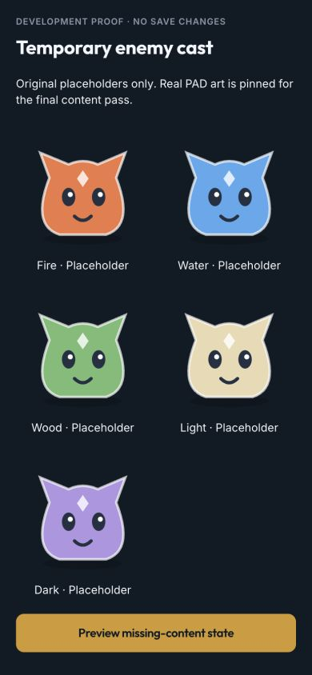
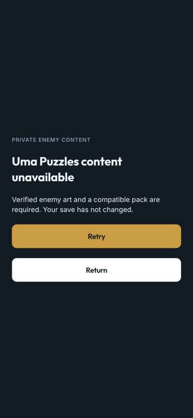

# Uma Puzzles private content — standing contract

**Production-placeholder release (D289–D290).** The owner approved an original, fully verified placeholder pack
for T116. T109 remains a later permitted PAD-art upgrade. The source research below records why originals are still
pending, not a readiness waiver: real host, hashes, coverage and retained leases remain mandatory.

### Original-placeholder release path (D289)

Original SVG code in `scripts/assets/src/puzzle-placeholder-art.ts` exports fifteen labelled members: five elements
times Scout/Guardian/Champion. Rank armour/crown and an element glyph distinguish silhouettes. No PAD names/art,
external requests, fake original provenance or combat values are generated. `source.access: 'original-placeholder'`
uses the exact `repo:scripts/assets/src/puzzle-placeholder-art.ts` reference; every name includes “placeholder”.
A mixed original/placeholder pack is rejected. Existing public/owner-export formats remain readable unchanged.

`pnpm assets:puzzles:placeholders` writes only ignored `content/originals/` PNGs and separate
`overrides/puzzles-placeholders.json` / `puzzles-placeholder-evidence.json`. Rerunning verifies immutable bytes;
it never replaces the owner's future real `puzzles-cast.json`. Pass these paths to the existing offline atlas and
data import commands, then validate/publish the complete content tree through the standing release runbook.
All native alpha/decode, exact hash/MIME/size, coverage, retention and lease checks still apply. Placeholder content
can satisfy readiness, but absent/broken content cannot fall back to a freshly invented cast. Cosmetic replacements
retain the frozen placeholder pack/art for suspended fights. The UI plainly says “Placeholder enemy art”.

## Source gate and privacy

The Fandom Monster Book was robots-blocked. Sanbon's checked policy also disallows automated access; neither is fetched
by this adapter, including redirects or mirror/proxy workarounds. Ilmina's current public landing page no longer supplies
its database, and the independent entry pages checked did not expose verified portraits. Search snippets and old URLs
are not evidence. On 2026-10-07 the owner asked to pin collection and use temporary placeholders while other work proceeds.

The remaining input is a permitted export or independently verified source for five elemental starter/evolution families,
including transparent PNG/WebP art and exact provenance/variant/hash evidence. Guardian/champion presentations should
use stronger evolution variants. One complete opening chapter plus valid joins across every generated chapter is required;
reusing families is allowed, claiming fourteen separately imported original rosters is not. No permitted PAD-original pack or art preview is claimed. The D289 original-placeholder pack is separate;
publication evidence lives in [release acceptance](../research/uma-puzzles-release-acceptance.md). No unrelated private Spark roster is read.

All extracted rows, original names, evidence, source files, caches, atlases and packs stay in ignored `content/` or
`scripts/assets/.cache/puzzles/`. Tests use invented creatures/URLs and generated pixels. No original PAD combat stats,
skills, scripts or rewards are accepted: T108's code-authored role/element recipes own the rules.

## Reviewed input v1

`content/overrides/puzzles-cast.json`:

```ts
{
  schemaVersion: 1, version: string, provenanceRevision: string,
  members: [{
    id: string, name: string, family: string, variant: string,
    elements: ('fire' | 'water' | 'wood' | 'light' | 'dark')[],
    roles: ('striker' | 'healer' | 'guard' | 'converter' | 'ward' | 'champion')[],
    source: { access: 'public' | 'owner-export' | 'original-placeholder', reference: string, revision: string, verifiedAt: string },
    art: { location: string, sha256: string, mimeType: 'image/png' | 'image/webp', variant: string }
  }]
}
```

Public locations are reviewed HTTPS URLs: no credentials, query tokens, port, fragment, literal private address or
blocked source host. An owner export uses `originals/<safe-id>.png|webp` inside `content/`; realpath checking rejects
symlink escapes. Its provenance reference may identify a restricted source, but the importer never fetches that page.
The export itself must be permitted. `verifiedAt` is canonical ISO UTC; revisions and identities use the bounded domain
ID grammar. IDs and family/variant pairs are unique. Members and tag lists normalize to stable sorted order.

`content/overrides/puzzles-source-evidence.json` is exactly:

```ts
{ schemaVersion: 1, revision: string,
  entries: [{ id, reference, artHash, artLocation, artVariant, verifiedAt }] }
```

Every entry must match its reviewed source member exactly, including selected art variant and byte hash. No duplicate,
missing or unknown evidence. This is a record of human/source verification, not a claim that a URL's shape proves ownership.
The importer validates all 392 nodes in the fourteen current chapters (including both Dark champion variants), not just
five colour labels. Future engine/recipe capabilities are refused explicitly.
Bulk coverage strictly validates each chapter/cast once, then resolves every node and both Dark variants with the same
private recipe helper used by the single-entry resolver. Full-output comparison tests cover all chapters; no recipe,
seed, number or replay hash changes. This avoids rebuilding an identical chapter once per node in each importer/client check.

## Commands and immutable output

```sh
pnpm assets:puzzles:import
pnpm data:puzzles:import
pnpm data:puzzles:validate
```

Asset import accepts `--offline`, `--content-dir=`, `--cache-dir=`, `--input=` and `--evidence=`; data commands accept
`--content-dir=` and `--input=`. Outputs must remain private/ignored. No command publishes or needs credentials.
Offline mode may read owner-export originals or verified source cache; it never fetches. Invalid cache bytes fail visibly
without an automatic reroll/redownload. Errors print generic diagnostics; successful commands print aggregates/hashes only.

Image download uses exact reviewed URLs with redirects refused, a 10-second whole-response timeout, at most two attempts
for transient server/network failures, and an 8 MiB streamed/declared byte bound. Authorization/format/integrity failures
are not retried. SHA-256 deduplicates/cache-addresses originals. Sharp decodes static PNG/WebP at at most 16,777,216 pixels
and 4096 px per source side; fully opaque/fully invisible art is refused. Originals remain in the private cache/export.

Contain without enlargement into transparent 256×256 frames, with 2 px transparent gutters. Deterministic lossless WebP
pages are at most 2048×2048 (seven 260 px strides per side). At most 512 members/32 pages per atlas. Rectangles cannot
overlap, including gutters, or leave page bounds; every frame and page must be used. Native-decode tests inspect gutters
and alpha. A separate `puzzles-monsters` namespace does not replace Uma/PriConne art.

```text
content/atlases/puzzles-monsters-<page>.<hash8>.webp
content/atlases/puzzles-monsters.<hash8>.json
content/data/puzzles-cast.<hash8>.json
content/data/puzzles-catalog.<hash8>.json
```

The asset stage pins `puzzles-atlas:<canonical-source-full-hash>` in manifest source metadata. Data compilation requires
that exact reviewed stage, verifies all referenced atlas objects, and substitutes source locations with immutable frame
IDs/source hashes. Pack v1 carries `capability: { engineVersion: 1, recipeVersion: 1 }`, provenance revision, names/family/
variant/tag/source rows, exact atlas `{path,bytes,sha256}`, and frame joins. Hash covers canonical normalized JSON, not a
self-referential hash field. Catalog v1 carries `activeHash` and up to 64 exact `{version,path,bytes,sha256}` references.

Same version with changed bytes is refused. Existing immutable files are verified, never overwritten. Old packs,
descriptors/pages remain retained on disk and in the combined manifest; catalog swaps are manifest-last and validated
before replacing the working manifest. No implicit pruning. Regular data reimport preserves all Puzzle packs/catalogs
and source pins; regular atlas import touches only its own families. The existing publisher checks any present Puzzle
catalog/pack before remote storage access, in addition to its existing RPG/Spark checks. Never publish a partial tree over
production; T116 owns the existing authorized publication runbook, not a new bucket/workflow.

## Lazy client and entry/resume contract

`apps/web/src/content/puzzles/discovery.ts` is cheap filename discovery only, **not readiness**. The lazy library fetches
through the existing bearer-authenticated `contentApi` and service-worker immutable content cache. Each JSON/image checks
exact MIME, byte count, full SHA-256 and filename prefix before parsing; JSON is limited to 2 MiB. WebP validates container,
static alpha capability/dimensions and native browser decode before any entry may succeed. Missing frames/art, future
schemas or incompatible engine/recipe versions never select a fake cast or another pack.

`load(identity?)` verifies metadata/joins; **only `acquire(identity?)` verifies all art and returns a presentation lease**.
New entry selects the catalog's active identity; resume supplies exact `{ version, contentHash }`. The returned pure cast
uses `manifestVersion = puzzles-<full-pack-sha256>`, fitting the existing engine input without changing its shape. T111 must
retain this exact identity/token when freezing a battle and re-acquire it on resume; absence blocks rather than rerolls.
Names/art never become combat parameters, and cosmetic changes preserve semantic replay hash/seed tests.

The library deduplicates in-flight requests, bounds metadata lookup to four packs and idle atlas pages to eight, and holds
every page before fetching. Active leases may exceed the idle bound. Release is idempotent; eviction skips held pages;
`clear()` revokes only unheld pages. Failed multi-page loads wait for every request to settle before dropping holds.
Existing manifest libraries stay valid for old leases when a new manifest arrives. Offline cached objects still verify;
missing cache is an explicit network/content failure, never a placeholder success.

The read-only lazy `/puzzles/content` preflight previews verified private art or **Uma Puzzles content unavailable** with
Retry/Return and a safe missing/integrity/incompatible/network diagnostic. It creates no run/reward/save mutation and has
no Home entry. `/dev/puzzles-content-proof` shows the original five-colour SVG stand-ins and unavailable UI without account
reads/writes. Placeholders are clearly named; they are not part of a production content pack or release-readiness predicate.

## Verification and outstanding acceptance

Synthetic tests cover strict parsers, unknown/future joins, deterministic canonical order/hash, cosmetic replay invariance,
native alpha/decode/multi-page gutters, dedup/offline/corrupt cache, permitted local exports/symlink refusal, MIME/size/retry,
immutable retention/reimport/publication refusal, authenticated client paths, verified offline restore, exact old packs,
held URL lifetime/overflow, missing art and visible Retry/Return. No tests contact the network. These bounded full-chapter
and native-codec integration suites use a local 30-second test timeout, after the two-core CI runner exceeded the default
five seconds; no workflow, global test limit or validation assertion was weakened.

The browser proof at 390×844 has no horizontal/page overflow; placeholders and both failure controls were inspected.
Screenshots show invented art only, not a final PAD cast or physical-iPhone acceptance. The code-only acceptance run
passed lint, all 1,220 tests, production build and `sim:puzzles` (888 synthetic battles plus 86,016 exact route/economy
variants; unchanged replay and balance output). Startup gzip is 152,238 bytes, the lazy content preflight/loader chunk
9,356 bytes and Spark's lazy chunk 18,089 bytes. No dependency or private production pack was added. The source pipeline
also normalizes grayscale-alpha originals to RGBA before transparency inspection and atlas composition.





**Pinned for later:** obtain permitted originals/evidence, run both imports, record timestamp + aggregate cast/element/role/
chapter/object/hash counts in ignored validation output, privately preview actual portraits, and publish/verify the complete
retained tree in T116. Delete T109's remaining spec only after that real-content acceptance. No source or device result is
fabricated by the code-only merge.
